# Figures

Generated by `_tools/ui_check/Screenshots.ps1`; under each figure, what its numbered badges mark, each with the control's tooltip where it has one.

## The main window

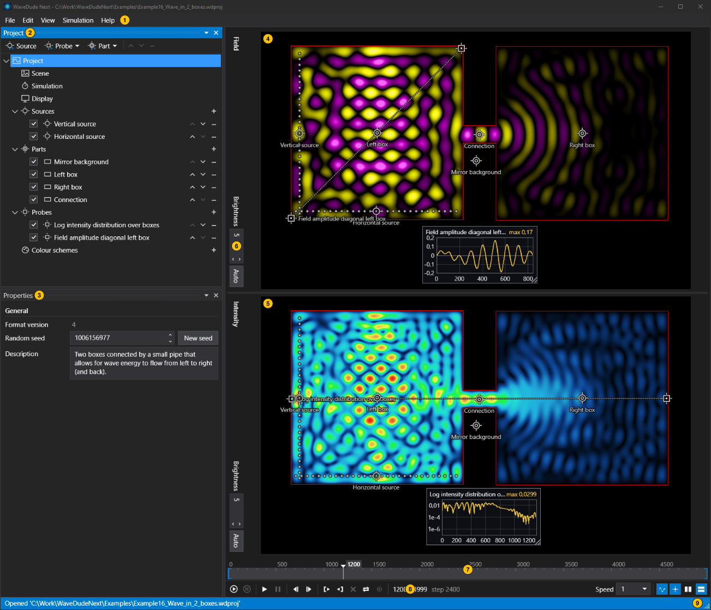

The main window with the example project at frame 1200.

1. **Menu bar**
2. **Project pane: the tree of the project's objects**
3. **Properties pane: the selected object's form**
4. **Field picture**
5. **Intensity picture**
6. **Header strip of a picture: title, brightness, Auto**  
   Gain applied to the values before the colour lookup.
7. **Timeline**  
   Click or drag to scrub; drag a bracket to move the start or end of the export range. Left/Right step a frame, PageUp/PageDown ten, Home/End jump to the start/end of the range
8. **Transport controls, position readout, speed, layout**  
   Frame shown / last frame
9. **Status bar**

## The project tree

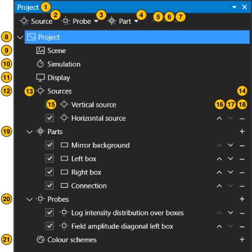

The Project pane with the example project.

1. **Pane title**
2. **Add a source**  
   Add a source (appended at the end)
3. **Add a probe**  
   Add a probe: a standard probe, or a probabilistic detector (appended at the end)
4. **Add a part (a menu of the kinds)**  
   Add an optical part (a menu of kinds; appended at the end)
5. **Move the selected object up**  
   Move up (Alt+Up); drag to reorder
6. **Move the selected object down**  
   Move down (Alt+Down); drag to reorder
7. **Remove the selected object**  
   Remove (Del)
8. **Project: the root row**
9. **Scene**
10. **Simulation**
11. **Display**
12. **Sources group**
13. **Expand or collapse a group**
14. **Add to this group**  
   Add an item to this folder
15. **Enabled**  
   Include the source in runs (Space on the row toggles it)
16. **Move up**  
   Move up (Alt+Up); drag to reorder
17. **Move down**  
   Move down (Alt+Down); drag to reorder
18. **Remove**  
   Remove (Del)
19. **Parts group**
20. **Probes group**
21. **Colour schemes group**

## The preview

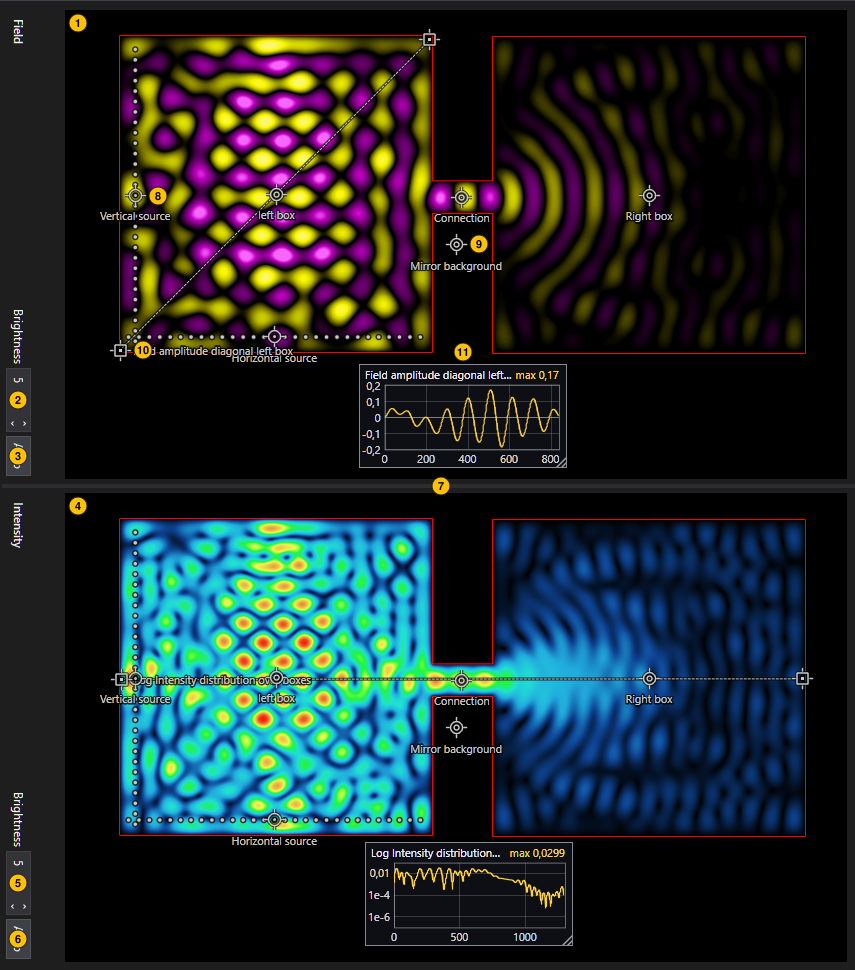

The preview: field and intensity pictures of the example project at frame 1200.

1. **Field picture**
2. **Brightness of the field picture**  
   Gain applied to the values before the colour lookup.
3. **Auto brightness (fit to the frame shown)**  
   Fit the brightness once to the frame shown: the brightest half percent of it reaches the top of the colour scheme. The brightness then stays as it is.
4. **Intensity picture**
5. **Brightness of the intensity picture**  
   Gain applied to the values before the colour lookup.
6. **Auto brightness of the intensity picture**  
   Fit the brightness once to the frame shown: the brightest half percent of it reaches the top of the colour scheme. The brightness then stays as it is.
7. **Splitter between the pictures**  
   Drag or use the arrow keys to resize; double-click or Enter resets to half
8. **Source handle (Vertical source)**  
   Vertical source: drag to move; with keyboard focus the arrow keys move it by a pixel, ten with Shift
9. **Part handle (Mirror background)**  
   Mirror background: drag to move; with keyboard focus the arrow keys move it by a pixel, ten with Shift
10. **Probe handle (Field amplitude diagonal left box, end A)**  
   Field amplitude diagonal left box: drag to move; with keyboard focus the arrow keys move it by a pixel, ten with Shift
11. **Probe graph box (Field amplitude diagonal left box)**  
   Graph of Field amplitude diagonal left box: drag to move the box; with keyboard focus the arrow keys move it by a pixel, ten with Shift

## The timeline

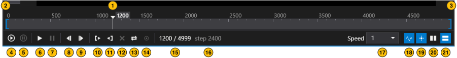

The timeline with the playhead and the in and out points, and the transport controls.

1. **Playhead: the position shown**
2. **In point**
3. **Out point**
4. **Run the simulation**  
   Run the simulation from the start (F5)
5. **Pause the simulation**  
   Pause the simulation (F6)
6. **Play**  
   Play (Space)
7. **Pause**  
   Pause (Space)
8. **One frame back**  
   Previous frame (,)
9. **One frame forward**  
   Next frame (.)
10. **Set the in point**  
   Start the export range at this frame (I)
11. **Set the out point**  
   End the export range at this frame (O)
12. **Clear the in and out points**  
   Clear the export range: the whole run is exported (X)
13. **Loop**  
   Loop playback over the export range (L)
14. **Live: follow a running run**  
   Follow the newest frame while the run is in progress (F)
15. **Position: frame of frames**  
   Frame shown / last frame
16. **Step of the position**  
   Simulation step of the frame shown
17. **Playback speed**  
   Playback speed: pick a factor or type one
18. **Show the field**  
   Show the field picture
19. **Show the intensity**  
   Show the intensity picture
20. **Pictures side by side**  
   Field and intensity side by side
21. **Pictures stacked**  
   Field above intensity

## The File menu

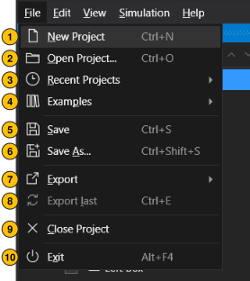

The File menu.

1. **New Project**
2. **Open Project...**
3. **Recent Projects**
4. **Examples**
5. **Save**
6. **Save As...**
7. **Export**
8. **Export last**
9. **Close Project**
10. **Exit**

## The Edit menu

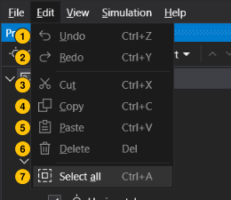

The Edit menu.

1. **Undo**
2. **Redo**
3. **Cut**
4. **Copy**
5. **Paste**
6. **Delete**
7. **Select all**

## The View menu

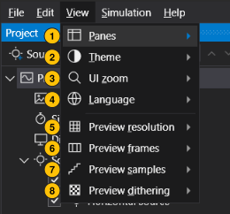

The View menu.

1. **Panes**
2. **Theme**
3. **UI zoom**
4. **Language**
5. **Preview resolution**
6. **Preview frames**
7. **Preview samples**
8. **Preview dithering**

## The Simulation menu

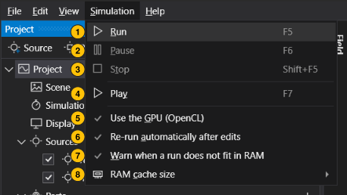

The Simulation menu.

1. **Run**
2. **Pause**
3. **Stop**
4. **Play**
5. **Use the GPU (OpenCL)**
6. **Re-run automatically after edits**
7. **Warn when a run does not fit in RAM**
8. **RAM cache size**

## The Help menu

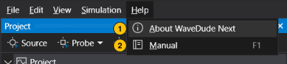

The Help menu.

1. **About WaveDude Next**
2. **Manual**

## File > Export

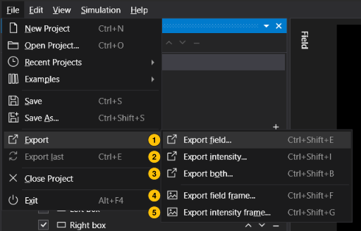

The File > Export submenu.

1. **Export field...**
2. **Export intensity...**
3. **Export both...**
4. **Export field frame...**
5. **Export intensity frame...**

## File > Examples

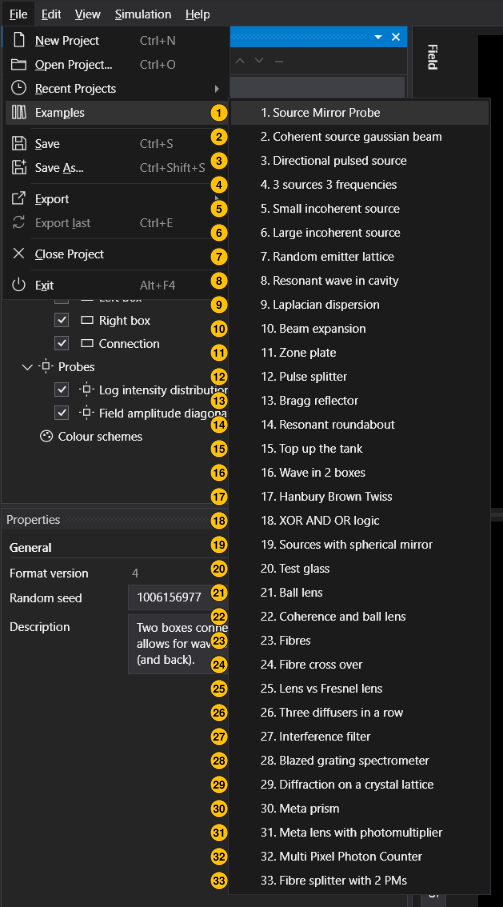

The File > Examples submenu: the shipped example projects.

1. **1. Source Mirror Probe**  
   Simple omnidirectional pulsed source with a smoothed square intensity profile, reflecting of simple mirror surface. A probe measures the intensity profile near the surface.
2. **2. Coherent source gaussian beam**  
   Featuring a 21 x 7 composite source that emits a continuous gaussian beam
3. **3. Directional pulsed source**  
   Featuring a coherent pulsed assembly of sources that emits a directional stream of wave pulses.
4. **4. 3 sources 3 frequencies**  
   Geometric wave pattern resulting from 3 sources with different frequencies
5. **5. Small incoherent source**  
   Simulation features a small (5x5 composite) source using randomized "off"-time and source frequency.
6. **6. Large incoherent source**  
   Featuring a large (450+ composite) source that creates both spatially- as well as temporally incoherent wave emission. The probes show that even though the intensity variations are large for an incoherent source, they eventually average out over time. Probe 2 shows the 1/r relationship. where r= distance to the source.
7. **7. Random emitter lattice**  
   Collection of 800+ sources distributed over the full animation space and emitting short random wave pulses with a varying frequency.
8. **8. Resonant wave in cavity**  
   Wave energy released at the center of a cavity at almost the resonance frequency.
9. **9. Laplacian dispersion**  
   Visualization of dispersion (wavelength-dependent propagation speed) when using a third order Laplacian. To remove the dispersion, check the 4th order Laplacian checkbox under "Simulation".
10. **10. Beam expansion**  
   A beam expander using a GRIN lens and a large confocal lens.
11. **11. Zone plate**  
   One source and a zone plate
12. **12. Pulse splitter**  
   Short coherent pulse divided by a beam splitter
13. **13. Bragg reflector**  
   Demo of a Bragg reflector. The layer thickness of each layer should be 1/4 lambda divided by the refractive index of the specific layer. However, reflectivity is strongly angle dependent.
14. **14. Resonant roundabout**  
   Resonant roundabout with two sources and two exits. If you change the phase of one of the sources by 180 degrees, waves will take the other exit.
15. **15. Top up the tank**  
   Filling a tank with radiative energy
16. **16. Wave in 2 boxes**  
   Two boxes connected by a small pipe that allows for wave energy to flow from left to right (and back).
17. **17. Hanbury Brown Twiss**  
   Switch on the small source and the two telescopes will see highly correlated signals. Switch on the large source and the correlation disappears. This is a demonstration of the area of coherence as can be measured in the HBT experiment to measure the ratio between the diameter and the distance of a star.
18. **18. XOR AND OR logic**  
   3 logical wave gates chained together
19. **19. Sources with spherical mirror**  
   Wave pulse emitted from the center of the curvature of a mirror, reflecting and then returning to the point of emission. Featuring timed probes. Notice that this simulation runs extremely fast on the GPU, when no video export is selected.
20. **20. Test glass**  
   The simulation shows the interference pattern created between two high-refractive index surfaces in close proximity of each other under a small angle.
21. **21. Ball lens**  
   Continuous point source and high refractive index ball lens. Probe 2A-B features 1/r intensity decay from the source with some interference of some reflections superimposed on it.
22. **22. Coherence and ball lens**  
   A coherent and directional source directing its waves at a ball lens with a high refractive index. It demonstrates Gaussian beam and Airy disk profiles
23. **23. Fibres**  
   Simulation of 3 different fibres:
- Top: single mode fibre
- Middle: narrow multi-mode fibre
- Bottom: wide multi-mode fibre
Includes the use of two probes, an A-B (line) field probe and a single point intensity probe.
24. **24. Fibre cross over**  
   Two single-mode fibres side by side, their cores a dozen pixels apart: the evanescent field of one reaches into the other, so light launched into fibre A crosses over into fibre B and back along the length, a directional coupler. The probe along A shows the beating, the cross-fibre probe the field across both cores. Switch source A off and B on to launch from the other fibre.
25. **25. Lens vs Fresnel lens**  
   The example shows the difference between a Fresnel lens and a standard lens. Both lenses have a short focal distance. The Fresnel lens is much thinner and thus much lighter; however, its beam is not as clean as that of a standard lens.
26. **26. Three diffusers in a row**  
   The example shows a beam passing through 3 diffusers, each with a different characteristic spatial wavelength of its roughness (1: shortest, 3: longest). You can see the effects of the individual diffusers by switching them on or off individually.
27. **27. Interference filter**  
   A quarter-wavelength stack interference filter reflects most of the energy in a pulse of frequency 100 (wavelength 16 px) but transmits frequency 50 (wavelength 32 px) almost completely.
28. **28. Blazed grating spectrometer**  
   Spectrometer containing a blazed (or "echelette") grating, which diffracts the waves from a source that emits 2 wavelengths under 2 slightly different angles. The lens performs a Fourier transform by separating the 2 wavelengths into two spatially separated focal points. You can switch on either source (or rotate the grating) to see the effect of either wavelength.
29. **29. Diffraction on a crystal lattice**  
   A high-frequency source irradiates a diffractive lattice. The lattice diffracts the radiation preferentially in specific directions, similar to a crystal structure in an X-ray beam. By rotating the "crystal" lattice, the diffraction angles change. By measuring the angles of the diffracted beams, the lattice structure can in principle be solved.
30. **30. Meta prism**  
   A directional source is irradiating a meta surface prism. In the Field image you can clearly see the direction of the wavefront change; however, because the number of diffractive elements is small, the intensity distribution is somewhat messy.
31. **31. Meta lens with photomultiplier**  
   The intensity of a weak pulsing source is detected with a photomultiplier, which is probabilistic and dependent on the intensity. In the focus, the intensity is high during a pulse and this leads to a high probability of detection events for Photomultiplier 2. The other one (Photomultiplier 1) is placed in an area with relatively low intensity and hardly triggers.
32. **32. Multi Pixel Photon Counter**  
   2 coherent weak sources create a diffraction pattern that is then detected by a Multi Pixel Photon Counter.
33. **33. Fibre splitter with 2 PMs**  
   Pulses travelling through a multi-mode fibre are detected by 2 probabilistic detectors, one at each end of the fibre split.

## The Add probe menu

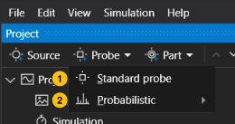

The Add probe menu of the project tree: a standard probe, or a probabilistic detector.

1. **Standard probe**  
   A standard probe: the field's amplitude, or the intensity's value or its integral, at a point over time or along a line.
2. **Probabilistic**

## Add probe > Probabilistic

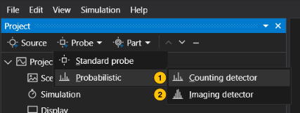

The Probabilistic submenu of the Add probe menu: the detectors.

1. **Counting detector**  
   A counting detector: the detections of the whole line, step by step, as a photomultiplier's pulses, drawn over time. Their rate is the line's intensity times the sensitivity; each detection is a chance.
2. **Imaging detector**  
   An imaging detector: the detections at every point of the line added up over the run, as a SPAD array or an image intensifier builds an image, drawn along the line.

## The Add part menu

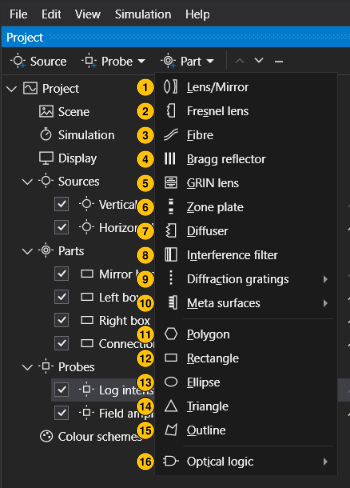

The Add part menu of the project tree: the kinds of optical parts.

1. **Lens/Mirror**  
   A lens or a mirror: a strip of the diameter between two spherical surfaces, each bulging outward, flat or hollow by the sign of its radius, the centre thickness apart. As a mirror it reflects everything; as a lens it refracts by its index, with an anti-reflection coating and absorption if wanted.
2. **Fresnel lens**  
   A Fresnel lens: a lens whose curved surfaces are cut into zones from the axis to the rim, equal in width or in depth, each zone's arc starting again at the vertex plane, so a thin plate bends light as a thick lens would. The settings are the lens's, with the number of zones and their division; a flat surface stays flat.
3. **Fibre**  
   A fibre: a core of higher index inside a cladding, along a smooth path of Bézier segments through its nodes, with flat or round ends. A wave coupled into the core is guided along the path; the cladding can absorb stray light at its rim.
4. **Bragg reflector**  
   A Bragg reflector: pairs of layers of two indices stacked along the axis. It reflects strongly around the wavelength the layer thicknesses are tuned to, a quarter wave each, and passes others.
5. **GRIN lens**  
   A gradient-index lens: a rectangle whose index falls from the axis to the edge in a parabolic profile, so it focuses like a lens with flat faces.
6. **Zone plate**  
   A zone plate: Fresnel zones cut for a design frequency and a focal length, every second zone an absorbing block, the central zone open or, inverted, a block. It focuses by diffraction; an optional mount stops light passing outside the diameter.
7. **Diffuser**  
   A diffuser: a plate of glass or mirror whose front face is rough, the back flat. The roughness is a spread of ripples about a centre wavelength, their phases random from the project's seed; it scatters what passes or reflects.
8. **Interference filter**  
   An interference filter: a plate of glass or mirror with a stack of thin layers on its front, each with its own thickness and index. Waves reflected at the layers' boundaries interfere, so the stack reflects some wavelengths and passes others; a new filter is a quarter-wave stack for a wavelength of 16 pixels.
9. **Diffraction gratings**
10. **Meta surfaces**
11. **Polygon**  
   A regular polygon of glass or mirror, by its number of sides and the side length.
12. **Rectangle**  
   A rectangle of glass or mirror, by length and width; linked, a square. A flat mirror is a long, narrow one.
13. **Ellipse**  
   An ellipse of glass or mirror, by the length and width of its box; linked, a circle.
14. **Triangle**  
   A triangle of glass or mirror: the base across the axis, the apex along it, the base angles set by a preset or by hand.
15. **Outline**  
   A free outline of glass or mirror: a closed shape through the points you place and drag; fewer than three paint nothing.
16. **Optical logic**

## Add part > Diffraction gratings

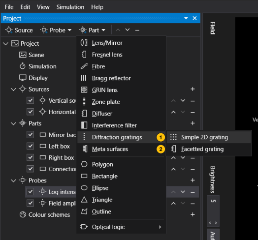

The Diffraction gratings submenu of the Add part menu.

1. **Simple 2D grating**  
   A simple 2D grating: a lattice of round dots, so many columns along the axis by so many rows across, each direction with its own spacing, nothing between them. The dots are mirror, or glass with an index; a wave passing the lattice is diffracted into the orders the spacings set. One column makes a line grating.
2. **Facetted grating**  
   A facetted grating: a plate of glass or mirror whose front face carries a periodic relief, a sawtooth, a square wave or a sinusoid repeated every pitch, the back flat. A diffuser of one wavelength: the pitch and the wavelength set the angles the orders leave at.

## menu-add-part-metasurfaces

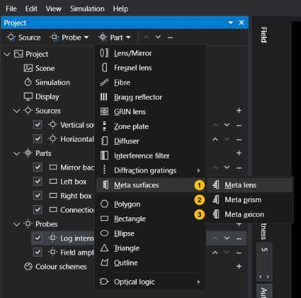

The Meta surfaces submenu of the Add part menu.

1. **Meta lens**  
   A meta lens: a carrier plate with a sub-wavelength pattern on its front, a ridge of its own index in every cell, whose fill is computed from the target frequency and the focal length so the cells delay the wave as a lens would, zone by zone. Converging or diverging; the pattern's tops and the plate's back can carry an anti-reflection coating.
2. **Meta prism**  
   A meta prism: a carrier plate with a sub-wavelength pattern on its front whose cells delay the wave in a line across the face, so a wave arriving along the axis leaves turned by a set angle, as a blazed grating's first order. Cut for a target frequency; the pattern's tops and the plate's back can carry an anti-reflection coating.
3. **Meta axicon**  
   A meta axicon: a carrier plate with a sub-wavelength pattern on its front whose cells delay the wave in proportion to the distance from the axis, so the two halves of a wave arriving along the axis are turned toward it by a set angle and cross along a line behind the surface rather than at a point. Cut for a target frequency; the pattern's tops and the plate's back can carry an anti-reflection coating.

## Add part > Optical logic

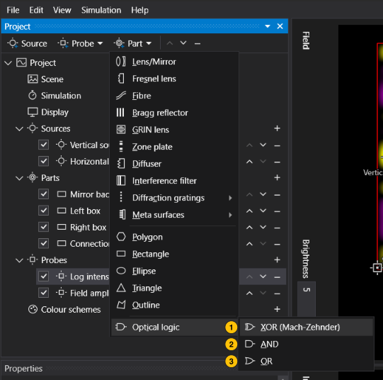

The Optical logic submenu of the Add part menu: the gates.

1. **XOR (Mach-Zehnder)**  
   An optical XOR gate: two input waveguides, a phase section putting the lower input a quarter period ahead, and a coupler whose upper output carries their difference. It lights when one input is lit, not both, for coherent inputs at the design frequency.
2. **AND**  
   An optical AND gate: the same coupler with the lower input a quarter period behind, so the upper output carries the sum. It is brightest with both inputs lit, about four times a single one; a passive linear gate has no truer AND.
3. **OR**  
   An optical OR gate: the same coupler with the lower input a twelfth of a period ahead, so the upper output carries half the power of either input and of both. It lights with one input or both.

## Project

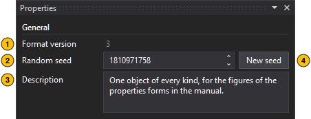

The project's own properties.

1. **Format version**  
   Version of the project file format.
2. **Random seed**
3. **Description**  
   Free-text notes about the project.
4. **New seed: a fresh random seed**

## Scene

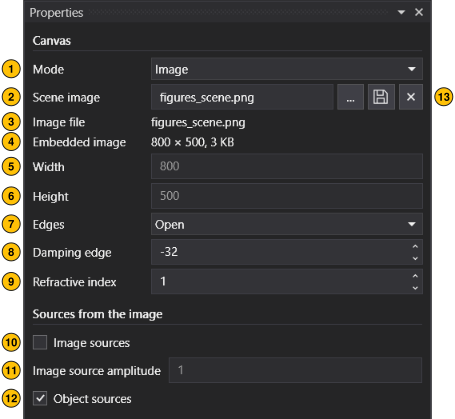

The Scene form (an image scene).

1. **Mode**  
   Blank canvas of the given size, or a canvas built from the scene image.
2. **Scene image**  
   Image the canvas is built from: red = refractive index (red 0 = a mirror), green = sources, blue = damping. The name of the embedded image, or a path relative to the project folder.
3. **Image file**  
   Where the embedded image came from; the embedded image is what is simulated, a missing file changes nothing. The file is watched while the project is open and re-embedded when it changes; on opening the project a changed file replaces the embedded image too.
4. **Embedded image**  
   Size of the embedded scene image; the canvas takes this size
5. **Width**  
   Width of a blank canvas in pixels.
6. **Height**  
   Height of a blank canvas in pixels.
7. **Edges**  
   Open lets a wave leave the grid, as if the canvas sat in open space; Reflective is a hard wall, as in Wave Dude 2D.
8. **Damping edge**  
   Thickness in pixels of the absorbing frame: positive inside the canvas, where it shows as a dark margin; negative outside it, simulated but never shown. 0 turns it off.
9. **Refractive index**  
   Refractive index of a blank canvas, 1.0 to 2.55. The wave speed is 1/n cells per step.
10. **Image sources**  
   Let the green channel of the scene image emit waves; the pixel value is the frequency level.
11. **Image source amplitude**  
   Peak amplitude of the image sources.
12. **Object sources**  
   Use the sources defined in the project.
13. **The image buttons: the dots pick an image file, the save glyph writes the embedded image out, the X drops it**  
   Pick an image file; it is embedded in the project

## Simulation

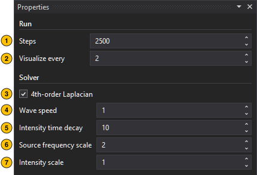

The Simulation form.

1. **Steps**  
   Total number of simulation steps.
2. **Visualize every**  
   Render a frame, export it and sample the probes every this many steps.
3. **4th-order Laplacian**  
   Use the 4th-order stencil with sub-stepping instead of the 9-point stencil. More accurate, slower.
4. **Wave speed**  
   Nominal wave speed in pixels per step; only used to estimate wavelengths in the editor.
5. **Intensity time decay**  
   Averaging window factor of the intensity: the engine averages over this × 100 / lowest source level steps.
6. **Source frequency scale**  
   Multiplier of the level-to-frequency mapping: ω = level / 255 × 0.5 × scale, in radians per step.
7. **Intensity scale**  
   Multiplier applied to the intensity values the engine produces.

## Display

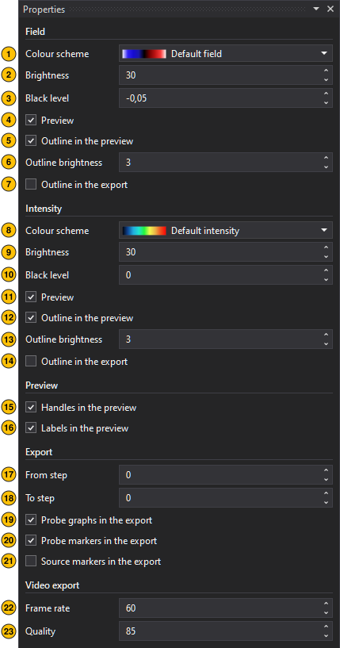

The Display form.

1. **Colour scheme**  
   Name of the colour scheme mapped onto the values.
2. **Brightness**  
   Gain applied to the values before the colour lookup.
3. **Black level**  
   Offset applied before the colour lookup; values at or below it map to the first colour.
4. **Preview**  
   Show this output in the live preview.
5. **Outline in the preview**  
   Lay the scene image's glowing-edges outline over this output in the preview.
6. **Outline brightness**  
   Multiplier of the outline: 1 as computed, higher lifts faint edges, 0 hides it.
7. **Outline in the export**  
   Bake the outline into exported frames and videos of this output.
8. **Colour scheme**  
   Name of the colour scheme mapped onto the values.
9. **Brightness**  
   Gain applied to the values before the colour lookup.
10. **Black level**  
   Offset applied before the colour lookup; values at or below it map to the first colour.
11. **Preview**  
   Show this output in the live preview.
12. **Outline in the preview**  
   Lay the scene image's glowing-edges outline over this output in the preview.
13. **Outline brightness**  
   Multiplier of the outline: 1 as computed, higher lifts faint edges, 0 hides it.
14. **Outline in the export**  
   Bake the outline into exported frames and videos of this output.
15. **Handles in the preview**  
   Show the handles, lines, emitter dots and levers of every source, part and probe over the preview pictures. A selected object shows its own either way.
16. **Labels in the preview**  
   Show the names beside the handles over the preview pictures. A selected object shows its own either way.
17. **From step**  
   First simulation step of the exported range; 0 is the start of the run.
18. **To step**  
   Last simulation step of the exported range; 0 means the end of the run.
19. **Probe graphs in the export**  
   Draw the probes' graph boxes over exported frames and videos.
20. **Probe markers in the export**  
   Draw the probes' positions (crosses, the line of a line probe, the number) over exported frames and videos.
21. **Source markers in the export**  
   Draw the enabled sources (the marker, a composite source's emitter dots, the name) over exported frames and videos.
22. **Frame rate**  
   Frames per second of the exported video.
23. **Quality**  
   Encoder quality, 1 to 100.

## Source

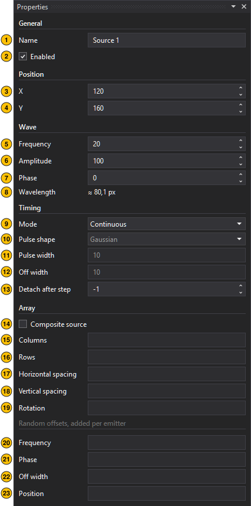

A point source.

1. **Name**  
   Name shown in the project tree and on the canvas.
2. **Enabled**  
   Include the source in simulation runs.
3. **X**  
   X of the emitter, or of the array centre, in canvas pixels.
4. **Y**  
   Y of the emitter, or of the array centre, in canvas pixels.
5. **Frequency**  
   Frequency as a level up to 255, decimals allowed, the same scale as the green channel of image sources. Above 255 the grid cannot sample the wave.
6. **Amplitude**  
   Amplitude in percent, 0 to 100, decimals allowed.
7. **Phase**  
   Phase offset in degrees, -180 to 180.
8. **Wavelength**  
   Estimated from the wave speed and the frequency (λ = c / f): emitters one wavelength apart radiate in phase along that direction. Holds for the 4th-order Laplacian; the 9-point stencil's speed varies with the frequency
9. **Mode**  
   Emit continuously or in bursts.
10. **Pulse shape**  
   Envelope of each burst; pulsed mode only.
11. **Pulse width**  
   Length of each burst in cycles of the source frequency; pulsed mode only.
12. **Off width**  
   Length of the gap between bursts in cycles; pulsed mode only.
13. **Detach after step**  
   Simulation step at which the source fades out; -1 keeps it on for the whole run.
14. **Composite source**  
   Emit from an array of emitters instead of a single point.
15. **Columns**  
   Number of emitters across. Odd counts keep the centre emitter on the source position.
16. **Rows**  
   Number of emitters down.
17. **Horizontal spacing**  
   Distance between neighbouring columns in canvas pixels.
18. **Vertical spacing**  
   Distance between neighbouring rows in canvas pixels.
19. **Rotation**  
   Rotation of the grid about the source position in degrees, counter-clockwise on the screen. 0 keeps the rows horizontal.
20. **Frequency**  
   Each emitter's level is offset by up to ± this amount. 0 turns it off.
21. **Phase**  
   Each emitter's phase is offset by up to ± this many degrees. 0 turns it off.
22. **Off width**  
   Each gap between bursts is offset by up to ± this many cycles, re-drawn every period. 0 turns it off.
23. **Position**  
   Each emitter is moved by up to ± this many pixels in X and in Y. 0 turns it off.

## Composite source

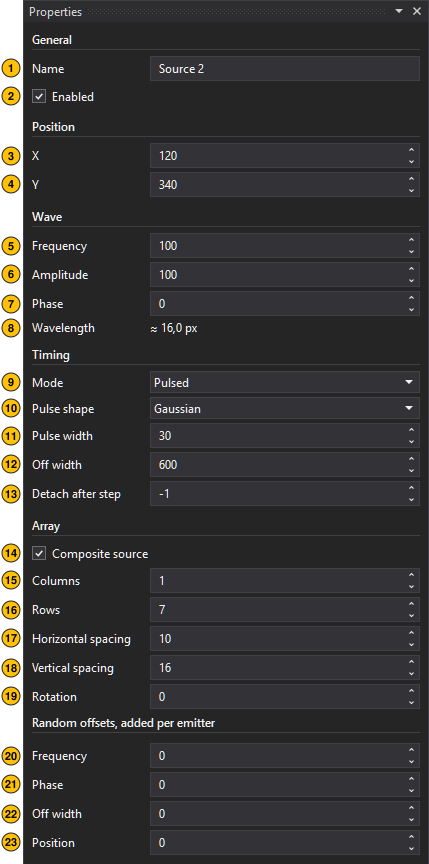

A composite (array) source, pulsed.

1. **Name**  
   Name shown in the project tree and on the canvas.
2. **Enabled**  
   Include the source in simulation runs.
3. **X**  
   X of the emitter, or of the array centre, in canvas pixels.
4. **Y**  
   Y of the emitter, or of the array centre, in canvas pixels.
5. **Frequency**  
   Frequency as a level up to 255, decimals allowed, the same scale as the green channel of image sources. Above 255 the grid cannot sample the wave.
6. **Amplitude**  
   Amplitude in percent, 0 to 100, decimals allowed.
7. **Phase**  
   Phase offset in degrees, -180 to 180.
8. **Wavelength**  
   Estimated from the wave speed and the frequency (λ = c / f): emitters one wavelength apart radiate in phase along that direction. Holds for the 4th-order Laplacian; the 9-point stencil's speed varies with the frequency
9. **Mode**  
   Emit continuously or in bursts.
10. **Pulse shape**  
   Envelope of each burst; pulsed mode only.
11. **Pulse width**  
   Length of each burst in cycles of the source frequency; pulsed mode only.
12. **Off width**  
   Length of the gap between bursts in cycles; pulsed mode only.
13. **Detach after step**  
   Simulation step at which the source fades out; -1 keeps it on for the whole run.
14. **Composite source**  
   Emit from an array of emitters instead of a single point.
15. **Columns**  
   Number of emitters across. Odd counts keep the centre emitter on the source position.
16. **Rows**  
   Number of emitters down.
17. **Horizontal spacing**  
   Distance between neighbouring columns in canvas pixels.
18. **Vertical spacing**  
   Distance between neighbouring rows in canvas pixels.
19. **Rotation**  
   Rotation of the grid about the source position in degrees, counter-clockwise on the screen. 0 keeps the rows horizontal.
20. **Frequency**  
   Each emitter's level is offset by up to ± this amount. 0 turns it off.
21. **Phase**  
   Each emitter's phase is offset by up to ± this many degrees. 0 turns it off.
22. **Off width**  
   Each gap between bursts is offset by up to ± this many cycles, re-drawn every period. 0 turns it off.
23. **Position**  
   Each emitter is moved by up to ± this many pixels in X and in Y. 0 turns it off.

## Lens

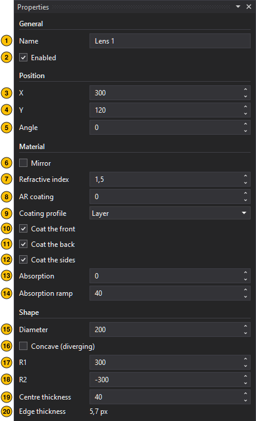

A lens or a mirror: a strip of the diameter between two spherical surfaces, each bulging outward, flat or hollow by the sign of its radius, the centre thickness apart. As a mirror it reflects everything; as a lens it refracts by its index, with an anti-reflection coating and absorption if wanted.

1. **Description of the kind, opened and closed with Space; one setting for every kind**  
   Show or hide what this kind of part is
2. **Name**  
   Name shown in the project tree and on the canvas.
3. **Enabled**  
   Paint the part into the scene; a disabled part has no effect on a run.
4. **X**  
   X of the part's centre in canvas pixels.
5. **Y**  
   Y of the part's centre in canvas pixels.
6. **Angle**  
   Rotation about the centre in degrees, counter-clockwise on the screen. 0 points the part's axis to the right.
7. **Mirror**  
   Make the part a mirror instead of a lens. The refractive index, the coating and the absorption are ignored then.
8. **Refractive index**  
   Refractive index of the glass, 1.00 to 2.55 in steps of 0.01.
9. **AR coating**  
   Thickness in pixels of the anti-reflection band just inside the outline; 0 for none. A quarter-wave layer is λ / (4 √n) pixels thick, λ being the wavelength the source form shows; a graded band is the better the thicker, from a wavelength on.
10. **Coating profile**  
   How the index runs through the band: a layer at √n, the quarter-wave idea, or a graded rise from the medium outside to the glass. A graded band reflects less than a layer once it is a wavelength thick or more, at any wavelength; a layer only at the wavelength it is cut for.
11. **Coat the front**  
   Put the band on the front: the faces turned toward a source on the left, a lens's first surface. Clear it to leave them bare, as the inner faces of a cavity are.
12. **Coat the back**  
   Put the band on the back: the faces turned away from a source on the left, a lens's second surface. Clear it to leave them bare.
13. **Coat the sides**  
   Put the band on the sides: the faces that are neither front nor back, a lens's rim, a slab's narrow ends. Clear it to leave them bare.
14. **Absorption**  
   How strongly the part absorbs waves, 0 (not at all) to 255, as the scene image's blue channel. It rises from nothing at the outline over the absorption ramp, so a wave enters the part instead of being reflected. A mirror ignores it.
15. **Absorption ramp**  
   Depth in pixels over which the absorption rises from nothing at the outline to its full value; the longer, the less of a wave is reflected. A part thinner than twice the ramp reaches its full absorption in its middle.
16. **Diameter**  
   Extent across the axis in pixels.
17. **Concave (diverging)**  
   Whether the lens diverges, its surfaces curving inward. Ticking it turns the lens around by flipping the sign of both radii; a flat surface stays flat.
18. **R1**  
   Radius of the first surface in pixels: positive bulges outward, negative is concave, 0 is flat. A radius too curved for the diameter and the centre thickness is raised to the smallest that fits.
19. **R2**  
   Radius of the second surface in pixels: negative bulges outward, positive is concave, 0 is flat. A radius too curved for the diameter and the centre thickness is raised to the smallest that fits.
20. **Centre thickness**  
   Distance between the two surfaces on the axis in pixels.
21. **Edge thickness**  
   Thickness at the rim: the centre thickness less what the convex surfaces take, plus what the concave ones add; 0 when the surfaces meet at the rim

## Fresnel lens

A Fresnel lens: a lens whose curved surfaces are cut into zones from the axis to the rim, equal in width or in depth, each zone's arc starting again at the vertex plane, so a thin plate bends light as a thick lens would. The settings are the lens's, with the number of zones and their division; a flat surface stays flat.

1. **Description of the kind, opened and closed with Space; one setting for every kind**  
   Show or hide what this kind of part is
2. **Name**  
   Name shown in the project tree and on the canvas.
3. **Enabled**  
   Paint the part into the scene; a disabled part has no effect on a run.
4. **X**  
   X of the part's centre in canvas pixels.
5. **Y**  
   Y of the part's centre in canvas pixels.
6. **Angle**  
   Rotation about the centre in degrees, counter-clockwise on the screen. 0 points the part's axis to the right.
7. **Mirror**  
   Make the part a mirror instead of a lens. The refractive index, the coating and the absorption are ignored then.
8. **Refractive index**  
   Refractive index of the glass, 1.00 to 2.55 in steps of 0.01.
9. **AR coating**  
   Thickness in pixels of the anti-reflection band just inside the outline; 0 for none. A quarter-wave layer is λ / (4 √n) pixels thick, λ being the wavelength the source form shows; a graded band is the better the thicker, from a wavelength on.
10. **Coating profile**  
   How the index runs through the band: a layer at √n, the quarter-wave idea, or a graded rise from the medium outside to the glass. A graded band reflects less than a layer once it is a wavelength thick or more, at any wavelength; a layer only at the wavelength it is cut for.
11. **Coat the front**  
   Put the band on the front: the faces turned toward a source on the left, a lens's first surface. Clear it to leave them bare, as the inner faces of a cavity are.
12. **Coat the back**  
   Put the band on the back: the faces turned away from a source on the left, a lens's second surface. Clear it to leave them bare.
13. **Coat the sides**  
   Put the band on the sides: the faces that are neither front nor back, a lens's rim, a slab's narrow ends. Clear it to leave them bare.
14. **Absorption**  
   How strongly the part absorbs waves, 0 (not at all) to 255, as the scene image's blue channel. It rises from nothing at the outline over the absorption ramp, so a wave enters the part instead of being reflected. A mirror ignores it.
15. **Absorption ramp**  
   Depth in pixels over which the absorption rises from nothing at the outline to its full value; the longer, the less of a wave is reflected. A part thinner than twice the ramp reaches its full absorption in its middle.
16. **Diameter**  
   Extent across the axis in pixels.
17. **R1**  
   Radius of the first surface in pixels: positive bulges outward, negative is concave, 0 is flat. A radius too curved for the diameter and the centre thickness is raised to the smallest that fits.
18. **R2**  
   Radius of the second surface in pixels: negative bulges outward, positive is concave, 0 is flat. A radius too curved for the diameter and the centre thickness is raised to the smallest that fits.
19. **Centre thickness**  
   Distance between the two surfaces on the axis in pixels.
20. **Zones**  
   Number of zones each curved surface is cut into, from the axis to the rim, equal in width or in depth as the zone division says. At each zone's inner edge the arc starts again at the vertex plane, so the plate stays thin; 1 is a plain lens.
21. **Zone division**  
   How the zones are divided from the axis to the rim: equal in width, the outer zone the deepest; or equal in depth, each zone cut to the same depth and the zones narrowing outward, as the elements of a lighthouse lens are.
22. **Edge thickness**  
   Thickness at the rim: the centre thickness less what the convex surfaces take, plus what the concave ones add; 0 when the surfaces meet at the rim

## Polygon

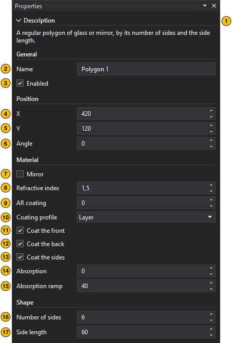

A regular polygon of glass or mirror, by its number of sides and the side length.

1. **Description of the kind, opened and closed with Space; one setting for every kind**  
   Show or hide what this kind of part is
2. **Name**  
   Name shown in the project tree and on the canvas.
3. **Enabled**  
   Paint the part into the scene; a disabled part has no effect on a run.
4. **X**  
   X of the part's centre in canvas pixels.
5. **Y**  
   Y of the part's centre in canvas pixels.
6. **Angle**  
   Rotation about the centre in degrees, counter-clockwise on the screen. 0 points the part's axis to the right.
7. **Mirror**  
   Make the part a mirror instead of glass. The refractive index, the coating and the absorption are ignored then.
8. **Refractive index**  
   Refractive index of the glass, 1.00 to 2.55 in steps of 0.01.
9. **AR coating**  
   Thickness in pixels of the anti-reflection band just inside the outline; 0 for none. A quarter-wave layer is λ / (4 √n) pixels thick, λ being the wavelength the source form shows; a graded band is the better the thicker, from a wavelength on.
10. **Coating profile**  
   How the index runs through the band: a layer at √n, the quarter-wave idea, or a graded rise from the medium outside to the glass. A graded band reflects less than a layer once it is a wavelength thick or more, at any wavelength; a layer only at the wavelength it is cut for.
11. **Coat the front**  
   Put the band on the front: the faces turned toward a source on the left, a lens's first surface. Clear it to leave them bare, as the inner faces of a cavity are.
12. **Coat the back**  
   Put the band on the back: the faces turned away from a source on the left, a lens's second surface. Clear it to leave them bare.
13. **Coat the sides**  
   Put the band on the sides: the faces that are neither front nor back, a lens's rim, a slab's narrow ends. Clear it to leave them bare.
14. **Absorption**  
   How strongly the part absorbs waves, 0 (not at all) to 255, as the scene image's blue channel. It rises from nothing at the outline over the absorption ramp, so a wave enters the part instead of being reflected. A mirror ignores it.
15. **Absorption ramp**  
   Depth in pixels over which the absorption rises from nothing at the outline to its full value; the longer, the less of a wave is reflected. A part thinner than twice the ramp reaches its full absorption in its middle.
16. **Number of sides**  
   Number of sides, 3 to 64.
17. **Side length**  
   Length of each side in pixels.

## Rectangle

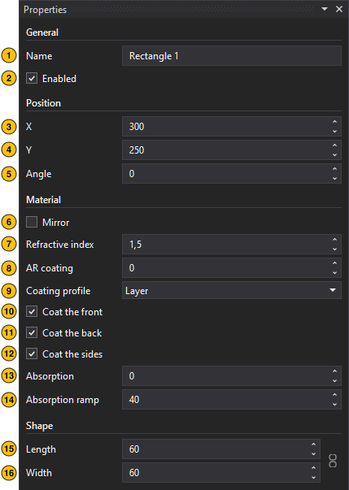

A rectangle of glass or mirror, by length and width; linked, a square. A flat mirror is a long, narrow one.

1. **Description of the kind, opened and closed with Space; one setting for every kind**  
   Show or hide what this kind of part is
2. **Name**  
   Name shown in the project tree and on the canvas.
3. **Enabled**  
   Paint the part into the scene; a disabled part has no effect on a run.
4. **X**  
   X of the part's centre in canvas pixels.
5. **Y**  
   Y of the part's centre in canvas pixels.
6. **Angle**  
   Rotation about the centre in degrees, counter-clockwise on the screen. 0 points the part's axis to the right.
7. **Mirror**  
   Make the part a mirror instead of glass. The refractive index, the coating and the absorption are ignored then.
8. **Refractive index**  
   Refractive index of the glass, 1.00 to 2.55 in steps of 0.01.
9. **AR coating**  
   Thickness in pixels of the anti-reflection band just inside the outline; 0 for none. A quarter-wave layer is λ / (4 √n) pixels thick, λ being the wavelength the source form shows; a graded band is the better the thicker, from a wavelength on.
10. **Coating profile**  
   How the index runs through the band: a layer at √n, the quarter-wave idea, or a graded rise from the medium outside to the glass. A graded band reflects less than a layer once it is a wavelength thick or more, at any wavelength; a layer only at the wavelength it is cut for.
11. **Coat the front**  
   Put the band on the front: the faces turned toward a source on the left, a lens's first surface. Clear it to leave them bare, as the inner faces of a cavity are.
12. **Coat the back**  
   Put the band on the back: the faces turned away from a source on the left, a lens's second surface. Clear it to leave them bare.
13. **Coat the sides**  
   Put the band on the sides: the faces that are neither front nor back, a lens's rim, a slab's narrow ends. Clear it to leave them bare.
14. **Absorption**  
   How strongly the part absorbs waves, 0 (not at all) to 255, as the scene image's blue channel. It rises from nothing at the outline over the absorption ramp, so a wave enters the part instead of being reflected. A mirror ignores it.
15. **Absorption ramp**  
   Depth in pixels over which the absorption rises from nothing at the outline to its full value; the longer, the less of a wave is reflected. A part thinner than twice the ramp reaches its full absorption in its middle.
16. **Length**  
   Extent along the axis in pixels.
17. **Width**  
   Extent across the axis in pixels.
18. **Linked: the chain keeps the width equal to the length**  
   Keep the width equal to the length: a square.

## Ellipse

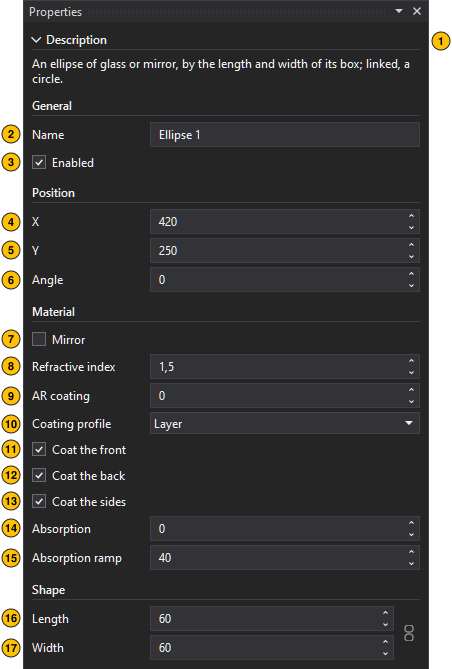

An ellipse of glass or mirror, by the length and width of its box; linked, a circle.

1. **Description of the kind, opened and closed with Space; one setting for every kind**  
   Show or hide what this kind of part is
2. **Name**  
   Name shown in the project tree and on the canvas.
3. **Enabled**  
   Paint the part into the scene; a disabled part has no effect on a run.
4. **X**  
   X of the part's centre in canvas pixels.
5. **Y**  
   Y of the part's centre in canvas pixels.
6. **Angle**  
   Rotation about the centre in degrees, counter-clockwise on the screen. 0 points the part's axis to the right.
7. **Mirror**  
   Make the part a mirror instead of glass. The refractive index, the coating and the absorption are ignored then.
8. **Refractive index**  
   Refractive index of the glass, 1.00 to 2.55 in steps of 0.01.
9. **AR coating**  
   Thickness in pixels of the anti-reflection band just inside the outline; 0 for none. A quarter-wave layer is λ / (4 √n) pixels thick, λ being the wavelength the source form shows; a graded band is the better the thicker, from a wavelength on.
10. **Coating profile**  
   How the index runs through the band: a layer at √n, the quarter-wave idea, or a graded rise from the medium outside to the glass. A graded band reflects less than a layer once it is a wavelength thick or more, at any wavelength; a layer only at the wavelength it is cut for.
11. **Coat the front**  
   Put the band on the front: the faces turned toward a source on the left, a lens's first surface. Clear it to leave them bare, as the inner faces of a cavity are.
12. **Coat the back**  
   Put the band on the back: the faces turned away from a source on the left, a lens's second surface. Clear it to leave them bare.
13. **Coat the sides**  
   Put the band on the sides: the faces that are neither front nor back, a lens's rim, a slab's narrow ends. Clear it to leave them bare.
14. **Absorption**  
   How strongly the part absorbs waves, 0 (not at all) to 255, as the scene image's blue channel. It rises from nothing at the outline over the absorption ramp, so a wave enters the part instead of being reflected. A mirror ignores it.
15. **Absorption ramp**  
   Depth in pixels over which the absorption rises from nothing at the outline to its full value; the longer, the less of a wave is reflected. A part thinner than twice the ramp reaches its full absorption in its middle.
16. **Length**  
   Diameter along the axis in pixels.
17. **Width**  
   Diameter across the axis in pixels.
18. **Linked: the chain keeps the width equal to the length**  
   Keep the width equal to the length: a circle.

## Triangle

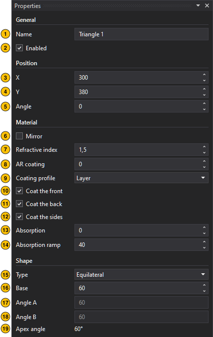

A triangle of glass or mirror: the base across the axis, the apex along it, the base angles set by a preset or by hand.

1. **Description of the kind, opened and closed with Space; one setting for every kind**  
   Show or hide what this kind of part is
2. **Name**  
   Name shown in the project tree and on the canvas.
3. **Enabled**  
   Paint the part into the scene; a disabled part has no effect on a run.
4. **X**  
   X of the part's centre in canvas pixels.
5. **Y**  
   Y of the part's centre in canvas pixels.
6. **Angle**  
   Rotation about the centre in degrees, counter-clockwise on the screen. 0 points the part's axis to the right.
7. **Mirror**  
   Make the part a mirror instead of glass. The refractive index, the coating and the absorption are ignored then.
8. **Refractive index**  
   Refractive index of the glass, 1.00 to 2.55 in steps of 0.01.
9. **AR coating**  
   Thickness in pixels of the anti-reflection band just inside the outline; 0 for none. A quarter-wave layer is λ / (4 √n) pixels thick, λ being the wavelength the source form shows; a graded band is the better the thicker, from a wavelength on.
10. **Coating profile**  
   How the index runs through the band: a layer at √n, the quarter-wave idea, or a graded rise from the medium outside to the glass. A graded band reflects less than a layer once it is a wavelength thick or more, at any wavelength; a layer only at the wavelength it is cut for.
11. **Coat the front**  
   Put the band on the front: the faces turned toward a source on the left, a lens's first surface. Clear it to leave them bare, as the inner faces of a cavity are.
12. **Coat the back**  
   Put the band on the back: the faces turned away from a source on the left, a lens's second surface. Clear it to leave them bare.
13. **Coat the sides**  
   Put the band on the sides: the faces that are neither front nor back, a lens's rim, a slab's narrow ends. Clear it to leave them bare.
14. **Absorption**  
   How strongly the part absorbs waves, 0 (not at all) to 255, as the scene image's blue channel. It rises from nothing at the outline over the absorption ramp, so a wave enters the part instead of being reflected. A mirror ignores it.
15. **Absorption ramp**  
   Depth in pixels over which the absorption rises from nothing at the outline to its full value; the longer, the less of a wave is reflected. A part thinner than twice the ramp reaches its full absorption in its middle.
16. **Type**  
   Equilateral, right isosceles (the 45° prism), 30-60-90, isosceles with one typed angle, or custom with both typed.
17. **Base**  
   Length of the base in pixels; the base lies across the axis, toward a source on the left.
18. **Angle A**  
   Base angle at the first end of the base, in degrees. Typed for the isosceles and custom types; the presets fix it.
19. **Angle B**  
   Base angle at the second end of the base, in degrees. Typed for the custom type; the others fix it.
20. **Apex angle**  
   The angle at the apex: 180° minus the two base angles

## Outline

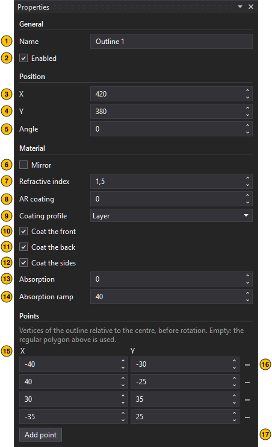

A free outline of glass or mirror: a closed shape through the points you place and drag; fewer than three paint nothing.

1. **Description of the kind, opened and closed with Space; one setting for every kind**  
   Show or hide what this kind of part is
2. **Name**  
   Name shown in the project tree and on the canvas.
3. **Enabled**  
   Paint the part into the scene; a disabled part has no effect on a run.
4. **X**  
   X of the part's centre in canvas pixels.
5. **Y**  
   Y of the part's centre in canvas pixels.
6. **Angle**  
   Rotation about the centre in degrees, counter-clockwise on the screen. 0 points the part's axis to the right.
7. **Mirror**  
   Make the part a mirror instead of glass. The refractive index, the coating and the absorption are ignored then.
8. **Refractive index**  
   Refractive index of the glass, 1.00 to 2.55 in steps of 0.01.
9. **AR coating**  
   Thickness in pixels of the anti-reflection band just inside the outline; 0 for none. A quarter-wave layer is λ / (4 √n) pixels thick, λ being the wavelength the source form shows; a graded band is the better the thicker, from a wavelength on.
10. **Coating profile**  
   How the index runs through the band: a layer at √n, the quarter-wave idea, or a graded rise from the medium outside to the glass. A graded band reflects less than a layer once it is a wavelength thick or more, at any wavelength; a layer only at the wavelength it is cut for.
11. **Coat the front**  
   Put the band on the front: the faces turned toward a source on the left, a lens's first surface. Clear it to leave them bare, as the inner faces of a cavity are.
12. **Coat the back**  
   Put the band on the back: the faces turned away from a source on the left, a lens's second surface. Clear it to leave them bare.
13. **Coat the sides**  
   Put the band on the sides: the faces that are neither front nor back, a lens's rim, a slab's narrow ends. Clear it to leave them bare.
14. **Absorption**  
   How strongly the part absorbs waves, 0 (not at all) to 255, as the scene image's blue channel. It rises from nothing at the outline over the absorption ramp, so a wave enters the part instead of being reflected. A mirror ignores it.
15. **Absorption ramp**  
   Depth in pixels over which the absorption rises from nothing at the outline to its full value; the longer, the less of a wave is reflected. A part thinner than twice the ramp reaches its full absorption in its middle.
16. **X**
17. **A point: X, Y, remove**  
   Remove this point
18. **Add a point**  
   Append a point after the last one

## Fibre

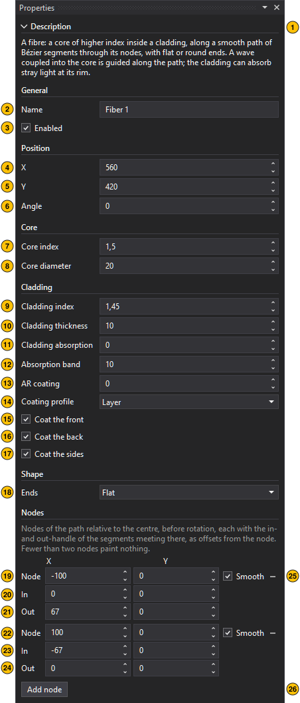

A fibre: a core of higher index inside a cladding, along a smooth path of Bézier segments through its nodes, with flat or round ends. A wave coupled into the core is guided along the path; the cladding can absorb stray light at its rim.

1. **Description of the kind, opened and closed with Space; one setting for every kind**  
   Show or hide what this kind of part is
2. **Name**  
   Name shown in the project tree and on the canvas.
3. **Enabled**  
   Paint the part into the scene; a disabled part has no effect on a run.
4. **X**  
   X of the part's centre in canvas pixels.
5. **Y**  
   Y of the part's centre in canvas pixels.
6. **Angle**  
   Rotation about the centre in degrees, counter-clockwise on the screen. 0 points the part's axis to the right.
7. **Core index**  
   Refractive index of the core, 1.00 to 2.55 in steps of 0.01.
8. **Core diameter**  
   Diameter of the core in pixels.
9. **Cladding index**  
   Refractive index of the cladding, 1.00 to 2.55 in steps of 0.01. Below the core's index, the fibre guides.
10. **Cladding thickness**  
   Thickness of the cladding around the core in pixels; 0 for a bare core.
11. **Cladding absorption**  
   Peak absorption of the cladding's absorbing band, 0 (not at all) to 255, as the scene image's blue channel: a hump in the outer part of the cladding, rising over the band width from nothing, peaking, and falling to nothing at the outer edge, so the guided wave's tail stays untouched and stray light is absorbed from either side. Nothing on a bare core.
12. **Absorption band**  
   Half the absorbing band's width in pixels: the absorption rises over this many pixels to its peak and falls over as many to the outer edge. A band wider than the cladding is squeezed into it.
13. **AR coating**  
   Thickness in pixels of the anti-reflection band just inside the outer boundary and the end faces; 0 for none. A quarter-wave layer is λ / (4 √n) pixels thick, λ being the wavelength the source form shows; a graded band is the better the thicker, from a wavelength on.
14. **Coating profile**  
   How the index runs through the band: a layer at √n, the quarter-wave idea, or a graded rise from the medium outside to the glass. A graded band reflects less than a layer once it is a wavelength thick or more, at any wavelength; a layer only at the wavelength it is cut for.
15. **Coat the front**  
   Put the band on the front: the faces turned toward a source on the left, a lens's first surface. Clear it to leave them bare, as the inner faces of a cavity are.
16. **Coat the back**  
   Put the band on the back: the faces turned away from a source on the left, a lens's second surface. Clear it to leave them bare.
17. **Coat the sides**  
   Put the band on the sides: the faces that are neither front nor back, a lens's rim, a slab's narrow ends. Clear it to leave them bare.
18. **Ends**  
   How the two ends are cut: flat, straight across the path like a cleaved fibre, or rounded with the outer radius. The AR coating follows a flat end face.
19. **Node**  
   X relative to the part's centre in canvas pixels, before rotation.
20. **In**  
   X of the in-handle relative to the node, in canvas pixels before rotation. It shapes the segment arriving from the previous node; zero makes that segment straight at this end.
21. **Out**  
   X of the out-handle relative to the node, in canvas pixels before rotation. It shapes the segment leaving to the next node; zero makes that segment straight at this end.
22. **Node**  
   X relative to the part's centre in canvas pixels, before rotation.
23. **In**  
   X of the in-handle relative to the node, in canvas pixels before rotation. It shapes the segment arriving from the previous node; zero makes that segment straight at this end.
24. **Out**  
   X of the out-handle relative to the node, in canvas pixels before rotation. It shapes the segment leaving to the next node; zero makes that segment straight at this end.
25. **Per node: smooth, remove**  
   Remove this node
26. **Add a node**  
   Append a node beyond the last one, continuing the path

## Bragg reflector

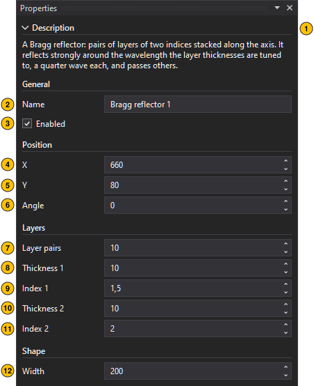

A Bragg reflector: pairs of layers of two indices stacked along the axis. It reflects strongly around the wavelength the layer thicknesses are tuned to, a quarter wave each, and passes others.

1. **Description of the kind, opened and closed with Space; one setting for every kind**  
   Show or hide what this kind of part is
2. **Name**  
   Name shown in the project tree and on the canvas.
3. **Enabled**  
   Paint the part into the scene; a disabled part has no effect on a run.
4. **X**  
   X of the part's centre in canvas pixels.
5. **Y**  
   Y of the part's centre in canvas pixels.
6. **Angle**  
   Rotation about the centre in degrees, counter-clockwise on the screen. 0 points the part's axis to the right.
7. **Layer pairs**  
   Number of layer pairs, 1 to 200.
8. **Thickness 1**  
   Thickness of the first layer of each pair in pixels. A quarter-wave layer is λ / (4 n) pixels thick.
9. **Index 1**  
   Refractive index of the first layer of each pair, 1.00 to 2.55 in steps of 0.01.
10. **Thickness 2**  
   Thickness of the second layer of each pair in pixels. A quarter-wave layer is λ / (4 n) pixels thick.
11. **Index 2**  
   Refractive index of the second layer of each pair, 1.00 to 2.55 in steps of 0.01.
12. **Width**  
   Extent of the stack across the axis in pixels.

## GRIN lens

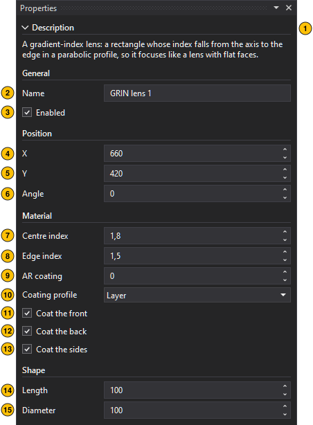

A gradient-index lens: a rectangle whose index falls from the axis to the edge in a parabolic profile, so it focuses like a lens with flat faces.

1. **Description of the kind, opened and closed with Space; one setting for every kind**  
   Show or hide what this kind of part is
2. **Name**  
   Name shown in the project tree and on the canvas.
3. **Enabled**  
   Paint the part into the scene; a disabled part has no effect on a run.
4. **X**  
   X of the part's centre in canvas pixels.
5. **Y**  
   Y of the part's centre in canvas pixels.
6. **Angle**  
   Rotation about the centre in degrees, counter-clockwise on the screen. 0 points the part's axis to the right.
7. **Centre index**  
   Refractive index on the axis, 1.00 to 2.55 in steps of 0.01.
8. **Edge index**  
   Refractive index at the edge, 1.00 to 2.55 in steps of 0.01. The profile between the axis and the edge is parabolic.
9. **AR coating**  
   Thickness in pixels of the anti-reflection band just inside the outline; 0 for none. A quarter-wave layer is λ / (4 √n) pixels thick, λ being the wavelength the source form shows; a graded band is the better the thicker, from a wavelength on.
10. **Coating profile**  
   How the index runs through the band: a layer at √n, the quarter-wave idea, or a graded rise from the medium outside to the glass. A graded band reflects less than a layer once it is a wavelength thick or more, at any wavelength; a layer only at the wavelength it is cut for.
11. **Coat the front**  
   Put the band on the front: the faces turned toward a source on the left, a lens's first surface. Clear it to leave them bare, as the inner faces of a cavity are.
12. **Coat the back**  
   Put the band on the back: the faces turned away from a source on the left, a lens's second surface. Clear it to leave them bare.
13. **Coat the sides**  
   Put the band on the sides: the faces that are neither front nor back, a lens's rim, a slab's narrow ends. Clear it to leave them bare.
14. **Length**  
   Extent along the axis in pixels.
15. **Diameter**  
   Extent across the axis in pixels.

## XOR gate

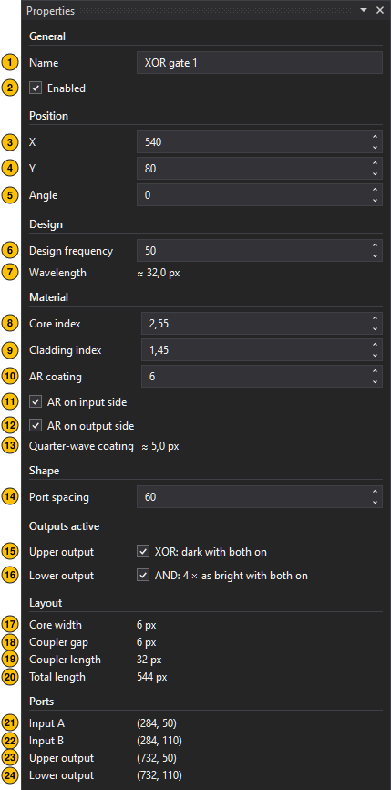

An optical XOR gate: two input waveguides, a phase section putting the lower input a quarter period ahead, and a coupler whose upper output carries their difference. It lights when one input is lit, not both, for coherent inputs at the design frequency.

1. **Description of the kind, opened and closed with Space; one setting for every kind**  
   Show or hide what this kind of part is
2. **Name**  
   Name shown in the project tree and on the canvas.
3. **Enabled**  
   Paint the part into the scene; a disabled part has no effect on a run.
4. **X**  
   X of the part's centre in canvas pixels.
5. **Y**  
   Y of the part's centre in canvas pixels.
6. **Angle**  
   Rotation about the centre in degrees, counter-clockwise on the screen. 0 points the part's axis to the right.
7. **Design frequency**  
   The source frequency the gate is designed for, on the same scale as a source's frequency: the frequency of the sources that drive it. The wavelength, and from it the core width, the coupler and the phase section, follow from it, so the gate works at this frequency only.
8. **Wavelength**  
   The wavelength the design frequency gives in a medium of index 1, with the simulation's source frequency scale
9. **Core index**  
   Refractive index of the waveguide cores, 1.00 to 2.55 in steps of 0.01. It must be above the cladding's; the larger the difference, the narrower the cores and the tighter the bends.
10. **Cladding index**  
   Refractive index of the cladding around the cores, 1.00 to 2.55 in steps of 0.01.
11. **AR coating**  
   Thickness in pixels of the anti-reflection band at the ends ticked below, with the index √n of the core and of the cladding; 0 for none. A quarter-wave band, the least reflecting, is λ / (4 √n) pixels thick; the form shows it for the core.
12. **AR on input side**  
   Put the anti-reflection band on the input end. Switch it off where the gate takes its light from a gate before it, so the wave passes through the junction.
13. **AR on output side**  
   Put the anti-reflection band on the output end. Switch it off where the gate hands its light to a gate after it, so the wave passes through the junction.
14. **Quarter-wave coating**  
   The thickness of the least reflecting coating on the core, λ / (4 √n)
15. **Port spacing**  
   Distance between the two inputs, and between the two outputs, in pixels. A value below what the design needs to keep the arms apart is raised to it, and the box shows the spacing used.
16. **Upper output**  
   Let the upper output's light leave the gate. Switched off, an absorber with a soft rise takes it in the last stretch of the arm.
17. **Lower output**  
   Let the lower output's light leave the gate. Switched off, an absorber with a soft rise takes it in the last stretch of the arm.
18. **Core width**
19. **Coupler gap**
20. **Coupler length**
21. **Total length**
22. **Input A**
23. **Input B**
24. **Upper output**
25. **Lower output**

## AND gate

An optical AND gate: the same coupler with the lower input a quarter period behind, so the upper output carries the sum. It is brightest with both inputs lit, about four times a single one; a passive linear gate has no truer AND.

1. **Description of the kind, opened and closed with Space; one setting for every kind**  
   Show or hide what this kind of part is
2. **Name**  
   Name shown in the project tree and on the canvas.
3. **Enabled**  
   Paint the part into the scene; a disabled part has no effect on a run.
4. **X**  
   X of the part's centre in canvas pixels.
5. **Y**  
   Y of the part's centre in canvas pixels.
6. **Angle**  
   Rotation about the centre in degrees, counter-clockwise on the screen. 0 points the part's axis to the right.
7. **Design frequency**  
   The source frequency the gate is designed for, on the same scale as a source's frequency: the frequency of the sources that drive it. The wavelength, and from it the core width, the coupler and the phase section, follow from it, so the gate works at this frequency only.
8. **Wavelength**  
   The wavelength the design frequency gives in a medium of index 1, with the simulation's source frequency scale
9. **Core index**  
   Refractive index of the waveguide cores, 1.00 to 2.55 in steps of 0.01. It must be above the cladding's; the larger the difference, the narrower the cores and the tighter the bends.
10. **Cladding index**  
   Refractive index of the cladding around the cores, 1.00 to 2.55 in steps of 0.01.
11. **AR coating**  
   Thickness in pixels of the anti-reflection band at the ends ticked below, with the index √n of the core and of the cladding; 0 for none. A quarter-wave band, the least reflecting, is λ / (4 √n) pixels thick; the form shows it for the core.
12. **AR on input side**  
   Put the anti-reflection band on the input end. Switch it off where the gate takes its light from a gate before it, so the wave passes through the junction.
13. **AR on output side**  
   Put the anti-reflection band on the output end. Switch it off where the gate hands its light to a gate after it, so the wave passes through the junction.
14. **Quarter-wave coating**  
   The thickness of the least reflecting coating on the core, λ / (4 √n)
15. **Port spacing**  
   Distance between the two inputs, and between the two outputs, in pixels. A value below what the design needs to keep the arms apart is raised to it, and the box shows the spacing used.
16. **Upper output**  
   Let the upper output's light leave the gate. Switched off, an absorber with a soft rise takes it in the last stretch of the arm.
17. **Lower output**  
   Let the lower output's light leave the gate. Switched off, an absorber with a soft rise takes it in the last stretch of the arm.
18. **Core width**
19. **Coupler gap**
20. **Coupler length**
21. **Total length**
22. **Input A**
23. **Input B**
24. **Upper output**
25. **Lower output**

## OR gate

An optical OR gate: the same coupler with the lower input a twelfth of a period ahead, so the upper output carries half the power of either input and of both. It lights with one input or both.

1. **Description of the kind, opened and closed with Space; one setting for every kind**  
   Show or hide what this kind of part is
2. **Name**  
   Name shown in the project tree and on the canvas.
3. **Enabled**  
   Paint the part into the scene; a disabled part has no effect on a run.
4. **X**  
   X of the part's centre in canvas pixels.
5. **Y**  
   Y of the part's centre in canvas pixels.
6. **Angle**  
   Rotation about the centre in degrees, counter-clockwise on the screen. 0 points the part's axis to the right.
7. **Design frequency**  
   The source frequency the gate is designed for, on the same scale as a source's frequency: the frequency of the sources that drive it. The wavelength, and from it the core width, the coupler and the phase section, follow from it, so the gate works at this frequency only.
8. **Wavelength**  
   The wavelength the design frequency gives in a medium of index 1, with the simulation's source frequency scale
9. **Core index**  
   Refractive index of the waveguide cores, 1.00 to 2.55 in steps of 0.01. It must be above the cladding's; the larger the difference, the narrower the cores and the tighter the bends.
10. **Cladding index**  
   Refractive index of the cladding around the cores, 1.00 to 2.55 in steps of 0.01.
11. **AR coating**  
   Thickness in pixels of the anti-reflection band at the ends ticked below, with the index √n of the core and of the cladding; 0 for none. A quarter-wave band, the least reflecting, is λ / (4 √n) pixels thick; the form shows it for the core.
12. **AR on input side**  
   Put the anti-reflection band on the input end. Switch it off where the gate takes its light from a gate before it, so the wave passes through the junction.
13. **AR on output side**  
   Put the anti-reflection band on the output end. Switch it off where the gate hands its light to a gate after it, so the wave passes through the junction.
14. **Quarter-wave coating**  
   The thickness of the least reflecting coating on the core, λ / (4 √n)
15. **Port spacing**  
   Distance between the two inputs, and between the two outputs, in pixels. A value below what the design needs to keep the arms apart is raised to it, and the box shows the spacing used.
16. **Upper output**  
   Let the upper output's light leave the gate. Switched off, an absorber with a soft rise takes it in the last stretch of the arm.
17. **Lower output**  
   Let the lower output's light leave the gate. Switched off, an absorber with a soft rise takes it in the last stretch of the arm.
18. **Core width**
19. **Coupler gap**
20. **Coupler length**
21. **Total length**
22. **Input A**
23. **Input B**
24. **Upper output**
25. **Lower output**

## Zone plate

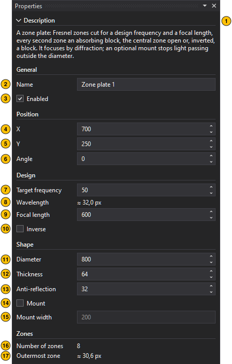

A zone plate: Fresnel zones cut for a design frequency and a focal length, every second zone an absorbing block, the central zone open or, inverted, a block. It focuses by diffraction; an optional mount stops light passing outside the diameter.

1. **Description of the kind, opened and closed with Space; one setting for every kind**  
   Show or hide what this kind of part is
2. **Name**  
   Name shown in the project tree and on the canvas.
3. **Enabled**  
   Paint the part into the scene; a disabled part has no effect on a run.
4. **X**  
   X of the part's centre in canvas pixels.
5. **Y**  
   Y of the part's centre in canvas pixels.
6. **Angle**  
   Rotation about the centre in degrees, counter-clockwise on the screen. 0 points the part's axis to the right.
7. **Target frequency**  
   The source frequency the plate is designed for, on the same scale as a source's frequency. The zones follow from the wavelength it gives, so the plate focuses this frequency at the focal length; other frequencies focus elsewhere.
8. **Wavelength**  
   The wavelength the design frequency gives in a medium of index 1, with the simulation's source frequency scale
9. **Focal length**  
   Distance in pixels from the plate to its focus, for a plane wave arriving along the axis.
10. **Inverse**  
   Exchange the zones: the central zone becomes a block, the first ring open, and so on. The focus stays where it is.
11. **Diameter**  
   Extent across the axis in pixels; the zones fill it.
12. **Thickness**  
   Extent along the axis in pixels: the depth of the blocks. It should leave room for the anti-reflection rise on both faces.
13. **Anti-reflection**  
   Depth in pixels over which a block's absorption rises from nothing at its faces to its full strength, so the blocks reflect little; at most half the thickness takes effect.
14. **Mount**  
   Surround the plate with an absorbing mount, so no light passes outside its diameter. Without it, that light meets the focused light on the axis and moves the focus further out, the more so the fewer zones the plate has.
15. **Mount width**  
   Width in pixels of the absorbing mount on either side, beyond the diameter.
16. **Number of zones**
17. **Outermost zone**

## Diffuser

A diffuser: a plate of glass or mirror whose front face is rough, the back flat. The roughness is a spread of ripples about a centre wavelength, their phases random from the project's seed; it scatters what passes or reflects.

1. **Description of the kind, opened and closed with Space; one setting for every kind**  
   Show or hide what this kind of part is
2. **Name**  
   Name shown in the project tree and on the canvas.
3. **Enabled**  
   Paint the part into the scene; a disabled part has no effect on a run.
4. **X**  
   X of the part's centre in canvas pixels.
5. **Y**  
   Y of the part's centre in canvas pixels.
6. **Angle**  
   Rotation about the centre in degrees, counter-clockwise on the screen. 0 points the part's axis to the right.
7. **Mirror**  
   Make the part a mirror instead of glass. The refractive index, the coating and the absorption are ignored then.
8. **Refractive index**  
   Refractive index of the glass, 1.00 to 2.55 in steps of 0.01.
9. **AR coating**  
   Thickness in pixels of the anti-reflection band just inside the outline; 0 for none. A quarter-wave layer is λ / (4 √n) pixels thick, λ being the wavelength the source form shows; a graded band is the better the thicker, from a wavelength on.
10. **Coating profile**  
   How the index runs through the band: a layer at √n, the quarter-wave idea, or a graded rise from the medium outside to the glass. A graded band reflects less than a layer once it is a wavelength thick or more, at any wavelength; a layer only at the wavelength it is cut for.
11. **Coat the front**  
   Put the band on the front: the faces turned toward a source on the left, a lens's first surface. Clear it to leave them bare, as the inner faces of a cavity are.
12. **Coat the back**  
   Put the band on the back: the faces turned away from a source on the left, a lens's second surface. Clear it to leave them bare.
13. **Coat the sides**  
   Put the band on the sides: the faces that are neither front nor back, a lens's rim, a slab's narrow ends. Clear it to leave them bare.
14. **Absorption**  
   How strongly the part absorbs waves, 0 (not at all) to 255, as the scene image's blue channel. It rises from nothing at the outline over the absorption ramp, so a wave enters the part instead of being reflected. A mirror ignores it.
15. **Absorption ramp**  
   Depth in pixels over which the absorption rises from nothing at the outline to its full value; the longer, the less of a wave is reflected. A part thinner than twice the ramp reaches its full absorption in its middle.
16. **Length**  
   Extent along the axis in pixels: the plate's thickness at the mean of its rough face.
17. **Width**  
   Extent across the axis in pixels: the width of the rough face.
18. **Centre wavelength**  
   The spatial wavelength in pixels at the middle of the roughness's spectrum: the ripple along the face that has the full amplitude. Two pixels at least.
19. **Amplitude**  
   The amplitude in pixels of the ripple at the centre wavelength. The other wavelengths of the spread get less, by their distance from the centre, and the face carries the sum of them all; 0 makes the face flat.
20. **Sigma**  
   The spread of the roughness's wavelengths about the centre wavelength, in pixels: a wavelength gets the amplitude times the bell e^(−(λ − centre)² / 2σ²). 0 leaves the centre wavelength alone, a single regular ripple; the larger, the more wavelengths join in and the less regular the face.
21. **Profile height**  
   The rough face from its highest point to its lowest: what the ripples add up to
22. **Ripples**  
   How many wavelengths make up the roughness: one at sigma 0, thirteen otherwise, those below two pixels left out

## Interference filter

An interference filter: a plate of glass or mirror with a stack of thin layers on its front, each with its own thickness and index. Waves reflected at the layers' boundaries interfere, so the stack reflects some wavelengths and passes others; a new filter is a quarter-wave stack for a wavelength of 16 pixels.

1. **Description of the kind, opened and closed with Space; one setting for every kind**  
   Show or hide what this kind of part is
2. **Name**  
   Name shown in the project tree and on the canvas.
3. **Enabled**  
   Paint the part into the scene; a disabled part has no effect on a run.
4. **X**  
   X of the part's centre in canvas pixels.
5. **Y**  
   Y of the part's centre in canvas pixels.
6. **Angle**  
   Rotation about the centre in degrees, counter-clockwise on the screen. 0 points the part's axis to the right.
7. **Mirror**  
   Make the part a mirror instead of glass. The refractive index, the coating and the absorption are ignored then.
8. **Refractive index**  
   Refractive index of the glass, 1.00 to 2.55 in steps of 0.01.
9. **AR coating**  
   Thickness in pixels of the anti-reflection band just inside the outline; 0 for none. A quarter-wave layer is λ / (4 √n) pixels thick, λ being the wavelength the source form shows; a graded band is the better the thicker, from a wavelength on.
10. **Coating profile**  
   How the index runs through the band: a layer at √n, the quarter-wave idea, or a graded rise from the medium outside to the glass. A graded band reflects less than a layer once it is a wavelength thick or more, at any wavelength; a layer only at the wavelength it is cut for.
11. **Coat the back**  
   Put the band on the back: the faces turned away from a source on the left, a lens's second surface. Clear it to leave them bare.
12. **Absorption**  
   How strongly the part absorbs waves, 0 (not at all) to 255, as the scene image's blue channel. It rises from nothing at the outline over the absorption ramp, so a wave enters the part instead of being reflected. A mirror ignores it.
13. **Absorption ramp**  
   Depth in pixels over which the absorption rises from nothing at the outline to its full value; the longer, the less of a wave is reflected. A part thinner than twice the ramp reaches its full absorption in its middle.
14. **Length**  
   Extent of the plate along the axis in pixels, without the layers, which lie on its front.
15. **Width**  
   Extent across the axis in pixels, of the plate and the layers alike.
16. **Stack thickness**  
   The layers' thicknesses added up: how far the stack stands out of the plate's front
17. **Per layer: grip, number, thickness, index, up, down, remove**  
   Remove this layer
18. **Add a layer**  
   Append a copy of the last layer
19. **Remove all layers**  
   Remove every layer, to build another stack from nothing; Undo brings them back

## Simple 2D grating

A simple 2D grating: a lattice of round dots, so many columns along the axis by so many rows across, each direction with its own spacing, nothing between them. The dots are mirror, or glass with an index; a wave passing the lattice is diffracted into the orders the spacings set. One column makes a line grating.

1. **Description of the kind, opened and closed with Space; one setting for every kind**  
   Show or hide what this kind of part is
2. **Name**  
   Name shown in the project tree and on the canvas.
3. **Enabled**  
   Paint the part into the scene; a disabled part has no effect on a run.
4. **X**  
   X of the part's centre in canvas pixels.
5. **Y**  
   Y of the part's centre in canvas pixels.
6. **Angle**  
   Rotation about the centre in degrees, counter-clockwise on the screen. 0 points the part's axis to the right.
7. **Mirror**  
   Make the part a mirror instead of glass. The refractive index, the coating and the absorption are ignored then.
8. **Refractive index**  
   Refractive index of the glass, 1.00 to 2.55 in steps of 0.01.
9. **Absorption**  
   How strongly the part absorbs waves, 0 (not at all) to 255, as the scene image's blue channel. It rises from nothing at the outline over the absorption ramp, so a wave enters the part instead of being reflected. A mirror ignores it.
10. **Absorption ramp**  
   Depth in pixels over which the absorption rises from nothing at the outline to its full value; the longer, the less of a wave is reflected. A part thinner than twice the ramp reaches its full absorption in its middle.
11. **Columns**  
   Number of dots along the axis. Odd counts keep the middle dot on the part's position; one column is a line grating across the axis.
12. **Rows**  
   Number of dots across the axis. Odd counts keep the middle dot on the part's position.
13. **Column spacing**  
   Distance between neighbouring columns along the axis in pixels: the grating's period in that direction. The dots can be at most half the smaller spacing across.
14. **Row spacing**  
   Distance between neighbouring rows across the axis in pixels: the grating's period in that direction. The dots can be at most half the smaller spacing across.
15. **Dot diameter**  
   Diameter of each dot in pixels, at most half the smaller spacing. A dot of 2 pixels on a whole-pixel position covers a square of 2 × 2 pixels; a mirror dot under 2 pixels covers no pixel centre and paints nothing.

## Facetted grating

A facetted grating: a plate of glass or mirror whose front face carries a periodic relief, a sawtooth, a square wave or a sinusoid repeated every pitch, the back flat. A diffuser of one wavelength: the pitch and the wavelength set the angles the orders leave at.

1. **Description of the kind, opened and closed with Space; one setting for every kind**  
   Show or hide what this kind of part is
2. **Name**  
   Name shown in the project tree and on the canvas.
3. **Enabled**  
   Paint the part into the scene; a disabled part has no effect on a run.
4. **X**  
   X of the part's centre in canvas pixels.
5. **Y**  
   Y of the part's centre in canvas pixels.
6. **Angle**  
   Rotation about the centre in degrees, counter-clockwise on the screen. 0 points the part's axis to the right.
7. **Mirror**  
   Make the part a mirror instead of glass. The refractive index, the coating and the absorption are ignored then.
8. **Refractive index**  
   Refractive index of the glass, 1.00 to 2.55 in steps of 0.01.
9. **AR coating**  
   Thickness in pixels of the anti-reflection band just inside the outline; 0 for none. A quarter-wave layer is λ / (4 √n) pixels thick, λ being the wavelength the source form shows; a graded band is the better the thicker, from a wavelength on.
10. **Coating profile**  
   How the index runs through the band: a layer at √n, the quarter-wave idea, or a graded rise from the medium outside to the glass. A graded band reflects less than a layer once it is a wavelength thick or more, at any wavelength; a layer only at the wavelength it is cut for.
11. **Coat the back**  
   Put the band on the back: the faces turned away from a source on the left, a lens's second surface. Clear it to leave them bare.
12. **Absorption**  
   How strongly the part absorbs waves, 0 (not at all) to 255, as the scene image's blue channel. It rises from nothing at the outline over the absorption ramp, so a wave enters the part instead of being reflected. A mirror ignores it.
13. **Absorption ramp**  
   Depth in pixels over which the absorption rises from nothing at the outline to its full value; the longer, the less of a wave is reflected. A part thinner than twice the ramp reaches its full absorption in its middle.
14. **Length**  
   Extent along the axis in pixels: the plate's thickness at the mean of its facetted face.
15. **Width**  
   Extent across the axis in pixels: the width of the facetted face.
16. **Pattern**  
   The facets' shape over each pitch: a sawtooth, a ramp then a step; a square wave, a crest and a trough of half a pitch each; or a sinusoid.
17. **Pitch**  
   The period of the facets across the face in pixels: the grating's pitch, which with the wavelength sets the diffraction angles. Two pixels at least.
18. **Amplitude**  
   The relief's height either side of the mean face in pixels: the facets run from this far out to this far in, twice it from crest to trough. 0 makes the face flat.

## Meta lens

A meta lens: a carrier plate with a sub-wavelength pattern on its front, a ridge of its own index in every cell, whose fill is computed from the target frequency and the focal length so the cells delay the wave as a lens would, zone by zone. Converging or diverging; the pattern's tops and the plate's back can carry an anti-reflection coating.

1. **Description of the kind, opened and closed with Space; one setting for every kind**  
   Show or hide what this kind of part is
2. **Name**  
   Name shown in the project tree and on the canvas.
3. **Enabled**  
   Paint the part into the scene; a disabled part has no effect on a run.
4. **X**  
   X of the part's centre in canvas pixels.
5. **Y**  
   Y of the part's centre in canvas pixels.
6. **Angle**  
   Rotation about the centre in degrees, counter-clockwise on the screen. 0 points the part's axis to the right.
7. **Mirror**  
   Make the part a mirror instead of glass. The refractive index, the coating and the absorption are ignored then.
8. **Refractive index**  
   Refractive index of the glass, 1.00 to 2.55 in steps of 0.01.
9. **AR coating**  
   Thickness in pixels of the anti-reflection band just inside the outline; 0 for none. A quarter-wave layer is λ / (4 √n) pixels thick, λ being the wavelength the source form shows; a graded band is the better the thicker, from a wavelength on.
10. **Coating profile**  
   How the index runs through the band: a layer at √n, the quarter-wave idea, or a graded rise from the medium outside to the glass. A graded band reflects less than a layer once it is a wavelength thick or more, at any wavelength; a layer only at the wavelength it is cut for.
11. **Coat the front**  
   Put the band on the front: the faces turned toward a source on the left, a lens's first surface. Clear it to leave them bare, as the inner faces of a cavity are.
12. **Coat the back**  
   Put the band on the back: the faces turned away from a source on the left, a lens's second surface. Clear it to leave them bare.
13. **Absorption**  
   How strongly the part absorbs waves, 0 (not at all) to 255, as the scene image's blue channel. It rises from nothing at the outline over the absorption ramp, so a wave enters the part instead of being reflected. A mirror ignores it.
14. **Absorption ramp**  
   Depth in pixels over which the absorption rises from nothing at the outline to its full value; the longer, the less of a wave is reflected. A part thinner than twice the ramp reaches its full absorption in its middle.
15. **Length**  
   Thickness of the carrier plate along the axis in pixels; the pattern stands on its front, outside it.
16. **Width**  
   Width of the plate and its pattern across the axis in pixels.
17. **Target frequency**  
   The source frequency the surface is designed for, on the same scale as a source's frequency. The cells' fill follows from the wavelength it gives, so the surface does its work at this frequency: a lens focuses it at the focal length, a prism turns it by its angle, an axicon by its cone angle. Another frequency sees another surface.
18. **Wavelength**  
   The wavelength the design frequency gives in a medium of index 1, with the simulation's source frequency scale
19. **Focal length**  
   Distance in pixels from the lens to its focus, for a plane wave arriving along the axis; a diverging lens spreads the wave as if from a focus that far behind it.
20. **Lens type**  
   Converging, the fill greatest at the centre and falling outward within each zone, as a convex lens's glass thins; or diverging, the fill growing outward.
21. **Zones**  
   The zones from the centre to the rim, each a full turn of phase, the last one cut by the rim
22. **Pattern index**  
   Refractive index of the ridges, 1.00 to 2.55 in steps of 0.01, usually above the plate's. The higher, the lower the pattern can be.
23. **Pitch**  
   The width of a cell of the pattern across the face in pixels, one ridge per cell. Well below the wavelength, so the wave sees each cell as a mean index rather than diffracting at it.
24. **Height**  
   The height of the ridges in front of the plate in pixels. A full turn of phase, which the zones need, takes a height of the wavelength over the pattern index less one; a lower pattern cannot delay enough and its fill saturates.
25. **Full-turn height**  
   The pattern height at which a filled cell delays by a whole turn, the wavelength over the pattern index less one; a lower pattern saturates

## Meta prism

A meta prism: a carrier plate with a sub-wavelength pattern on its front whose cells delay the wave in a line across the face, so a wave arriving along the axis leaves turned by a set angle, as a blazed grating's first order. Cut for a target frequency; the pattern's tops and the plate's back can carry an anti-reflection coating.

1. **Description of the kind, opened and closed with Space; one setting for every kind**  
   Show or hide what this kind of part is
2. **Name**  
   Name shown in the project tree and on the canvas.
3. **Enabled**  
   Paint the part into the scene; a disabled part has no effect on a run.
4. **X**  
   X of the part's centre in canvas pixels.
5. **Y**  
   Y of the part's centre in canvas pixels.
6. **Angle**  
   Rotation about the centre in degrees, counter-clockwise on the screen. 0 points the part's axis to the right.
7. **Mirror**  
   Make the part a mirror instead of glass. The refractive index, the coating and the absorption are ignored then.
8. **Refractive index**  
   Refractive index of the glass, 1.00 to 2.55 in steps of 0.01.
9. **AR coating**  
   Thickness in pixels of the anti-reflection band just inside the outline; 0 for none. A quarter-wave layer is λ / (4 √n) pixels thick, λ being the wavelength the source form shows; a graded band is the better the thicker, from a wavelength on.
10. **Coating profile**  
   How the index runs through the band: a layer at √n, the quarter-wave idea, or a graded rise from the medium outside to the glass. A graded band reflects less than a layer once it is a wavelength thick or more, at any wavelength; a layer only at the wavelength it is cut for.
11. **Coat the front**  
   Put the band on the front: the faces turned toward a source on the left, a lens's first surface. Clear it to leave them bare, as the inner faces of a cavity are.
12. **Coat the back**  
   Put the band on the back: the faces turned away from a source on the left, a lens's second surface. Clear it to leave them bare.
13. **Absorption**  
   How strongly the part absorbs waves, 0 (not at all) to 255, as the scene image's blue channel. It rises from nothing at the outline over the absorption ramp, so a wave enters the part instead of being reflected. A mirror ignores it.
14. **Absorption ramp**  
   Depth in pixels over which the absorption rises from nothing at the outline to its full value; the longer, the less of a wave is reflected. A part thinner than twice the ramp reaches its full absorption in its middle.
15. **Length**  
   Thickness of the carrier plate along the axis in pixels; the pattern stands on its front, outside it.
16. **Width**  
   Width of the plate and its pattern across the axis in pixels.
17. **Target frequency**  
   The source frequency the surface is designed for, on the same scale as a source's frequency. The cells' fill follows from the wavelength it gives, so the surface does its work at this frequency: a lens focuses it at the focal length, a prism turns it by its angle, an axicon by its cone angle. Another frequency sees another surface.
18. **Wavelength**  
   The wavelength the design frequency gives in a medium of index 1, with the simulation's source frequency scale
19. **Deflection**  
   The angle in degrees by which a wave arriving along the axis is turned, counter-clockwise on the screen for a positive angle; 0 turns nothing. The steeper, the narrower the zones, which must stay a few cells wide.
20. **Zone width**  
   The width of a zone across the face, a full turn of phase: the wavelength over the sine of the deflection
21. **Zones**  
   The zones from the centre to the rim, each a full turn of phase, the last one cut by the rim
22. **Pattern index**  
   Refractive index of the ridges, 1.00 to 2.55 in steps of 0.01, usually above the plate's. The higher, the lower the pattern can be.
23. **Pitch**  
   The width of a cell of the pattern across the face in pixels, one ridge per cell. Well below the wavelength, so the wave sees each cell as a mean index rather than diffracting at it.
24. **Height**  
   The height of the ridges in front of the plate in pixels. A full turn of phase, which the zones need, takes a height of the wavelength over the pattern index less one; a lower pattern cannot delay enough and its fill saturates.
25. **Full-turn height**  
   The pattern height at which a filled cell delays by a whole turn, the wavelength over the pattern index less one; a lower pattern saturates

## Meta axicon

A meta axicon: a carrier plate with a sub-wavelength pattern on its front whose cells delay the wave in proportion to the distance from the axis, so the two halves of a wave arriving along the axis are turned toward it by a set angle and cross along a line behind the surface rather than at a point. Cut for a target frequency; the pattern's tops and the plate's back can carry an anti-reflection coating.

1. **Description of the kind, opened and closed with Space; one setting for every kind**  
   Show or hide what this kind of part is
2. **Name**  
   Name shown in the project tree and on the canvas.
3. **Enabled**  
   Paint the part into the scene; a disabled part has no effect on a run.
4. **X**  
   X of the part's centre in canvas pixels.
5. **Y**  
   Y of the part's centre in canvas pixels.
6. **Angle**  
   Rotation about the centre in degrees, counter-clockwise on the screen. 0 points the part's axis to the right.
7. **Mirror**  
   Make the part a mirror instead of glass. The refractive index, the coating and the absorption are ignored then.
8. **Refractive index**  
   Refractive index of the glass, 1.00 to 2.55 in steps of 0.01.
9. **AR coating**  
   Thickness in pixels of the anti-reflection band just inside the outline; 0 for none. A quarter-wave layer is λ / (4 √n) pixels thick, λ being the wavelength the source form shows; a graded band is the better the thicker, from a wavelength on.
10. **Coating profile**  
   How the index runs through the band: a layer at √n, the quarter-wave idea, or a graded rise from the medium outside to the glass. A graded band reflects less than a layer once it is a wavelength thick or more, at any wavelength; a layer only at the wavelength it is cut for.
11. **Coat the front**  
   Put the band on the front: the faces turned toward a source on the left, a lens's first surface. Clear it to leave them bare, as the inner faces of a cavity are.
12. **Coat the back**  
   Put the band on the back: the faces turned away from a source on the left, a lens's second surface. Clear it to leave them bare.
13. **Absorption**  
   How strongly the part absorbs waves, 0 (not at all) to 255, as the scene image's blue channel. It rises from nothing at the outline over the absorption ramp, so a wave enters the part instead of being reflected. A mirror ignores it.
14. **Absorption ramp**  
   Depth in pixels over which the absorption rises from nothing at the outline to its full value; the longer, the less of a wave is reflected. A part thinner than twice the ramp reaches its full absorption in its middle.
15. **Length**  
   Thickness of the carrier plate along the axis in pixels; the pattern stands on its front, outside it.
16. **Width**  
   Width of the plate and its pattern across the axis in pixels.
17. **Target frequency**  
   The source frequency the surface is designed for, on the same scale as a source's frequency. The cells' fill follows from the wavelength it gives, so the surface does its work at this frequency: a lens focuses it at the focal length, a prism turns it by its angle, an axicon by its cone angle. Another frequency sees another surface.
18. **Wavelength**  
   The wavelength the design frequency gives in a medium of index 1, with the simulation's source frequency scale
19. **Cone angle**  
   The angle in degrees by which each half of a wave arriving along the axis is turned toward it. The steeper, the shorter the line of focus behind the surface and the narrower the zones, which must stay a few cells wide.
20. **Line of focus**  
   How far behind the surface the line of focus reaches: half the width over the tangent of the cone angle, where the rim's rays cross the axis
21. **Zone width**  
   The width of a zone across the face, a full turn of phase: the wavelength over the sine of the deflection
22. **Zones**  
   The zones from the centre to the rim, each a full turn of phase, the last one cut by the rim
23. **Pattern index**  
   Refractive index of the ridges, 1.00 to 2.55 in steps of 0.01, usually above the plate's. The higher, the lower the pattern can be.
24. **Pitch**  
   The width of a cell of the pattern across the face in pixels, one ridge per cell. Well below the wavelength, so the wave sees each cell as a mean index rather than diffracting at it.
25. **Height**  
   The height of the ridges in front of the plate in pixels. A full turn of phase, which the zones need, takes a height of the wavelength over the pattern index less one; a lower pattern cannot delay enough and its fill saturates.
26. **Full-turn height**  
   The pattern height at which a filled cell delays by a whole turn, the wavelength over the pattern index less one; a lower pattern saturates

## Probe

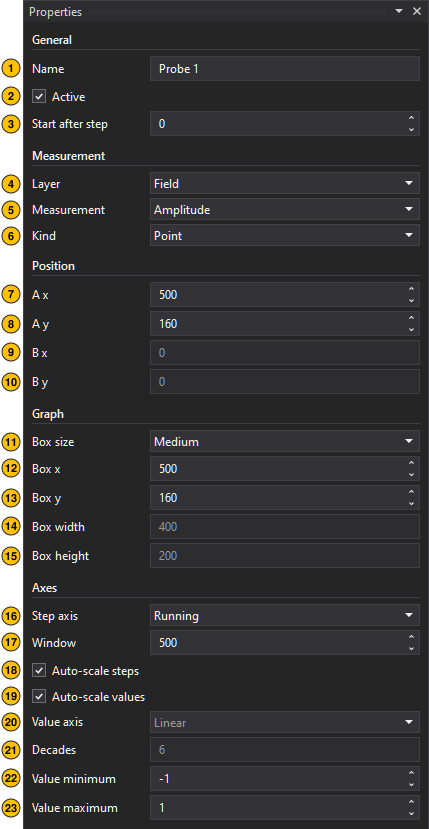

A point probe of the field.

1. **Name**  
   Name shown in the project tree and in the graph title.
2. **Active**  
   Sample and draw this probe.
3. **Start after step**  
   Step at which recording starts; 0 records from the first step.
4. **Detector**  
   A standard probe, or a probabilistic detector: counting, the detections of the whole line step by step over time, as a photomultiplier's pulses; or imaging, the detections at every point of the line added up over the run, as a SPAD array builds an image. A detector is a line probe of the integrated intensity.
5. **Detector sensitivity**  
   Expected detections per unit of intensity per step at a point of the line: the detector's quantum efficiency and the scale from intensity to detections in one number. The detections are Poisson-distributed about intensity × sensitivity; 0 detects nothing.
6. **Bin size**  
   Pixels of the line per bin of an imaging detector's histogram, 1 to 20: the detections of a bin's pixels are added up, and the graph shows the bin's total across them. Wider bins fill faster and show less detail.
7. **Layer**  
   Output the probe samples and is drawn on.
8. **Measurement**  
   Recorded quantity. The field offers its amplitude only; the intensity layer its value, or the value integrated over the run.
9. **Kind**  
   A single point, or a line from A to B.
10. **A x**  
   X of the probe pixel, or of the start of the line, in canvas pixels.
11. **A y**  
   Y of the probe pixel, or of the start of the line, in canvas pixels.
12. **B x**  
   X of the end of the line in canvas pixels; line probes only.
13. **B y**  
   Y of the end of the line in canvas pixels; line probes only.
14. **Box size**  
   Nominal size of the graph box drawn over the output; a box larger than the canvas is shrunk to fit it, aspect kept.
15. **Box x**  
   Left edge of the graph box in canvas pixels. A box placed on the probe's point A moves with the probe; dragging it close snaps it on.
16. **Box y**  
   Top edge of the graph box in canvas pixels. A box placed on the probe's point A moves with the probe; dragging it close snaps it on.
17. **Box width**  
   Width of the graph box in canvas pixels; custom box size only. A box larger than the canvas is shrunk to fit it, aspect kept.
18. **Box height**  
   Height of the graph box in canvas pixels; custom box size only. A box larger than the canvas is shrunk to fit it, aspect kept.
19. **Step axis**  
   Sliding window of the last steps, or the whole run; point probes and counting detectors only.
20. **Window**  
   Width of the sliding step window, in steps.
21. **Auto-scale steps**  
   Let the step axis follow the samples recorded so far; point probes and counting detectors only.
22. **Auto-scale values**  
   Fit the value axis to the data instead of the fixed minimum and maximum.
23. **Value axis**  
   A linear or a logarithmic value axis; intensity probes only, the field is always linear.
24. **Decades**  
   Decades a logarithmic value axis spans below its top; smaller values, zero included, sit on the bottom line.
25. **Value minimum**  
   Lower bound of the value axis when it is not auto-scaled.
26. **Value maximum**  
   Upper bound of the value axis when it is not auto-scaled.

## Line probe

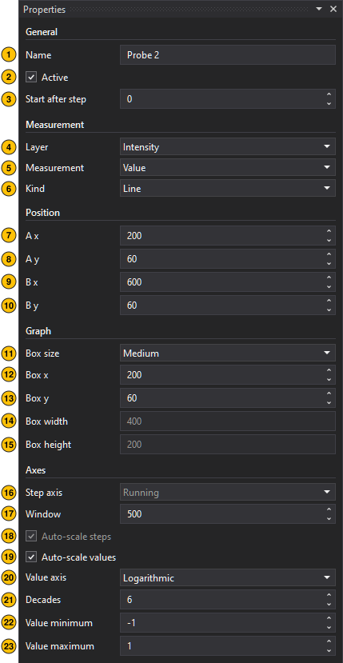

A line probe of the intensity, logarithmic.

1. **Name**  
   Name shown in the project tree and in the graph title.
2. **Active**  
   Sample and draw this probe.
3. **Start after step**  
   Step at which recording starts; 0 records from the first step.
4. **Detector**  
   A standard probe, or a probabilistic detector: counting, the detections of the whole line step by step over time, as a photomultiplier's pulses; or imaging, the detections at every point of the line added up over the run, as a SPAD array builds an image. A detector is a line probe of the integrated intensity.
5. **Detector sensitivity**  
   Expected detections per unit of intensity per step at a point of the line: the detector's quantum efficiency and the scale from intensity to detections in one number. The detections are Poisson-distributed about intensity × sensitivity; 0 detects nothing.
6. **Bin size**  
   Pixels of the line per bin of an imaging detector's histogram, 1 to 20: the detections of a bin's pixels are added up, and the graph shows the bin's total across them. Wider bins fill faster and show less detail.
7. **Layer**  
   Output the probe samples and is drawn on.
8. **Measurement**  
   Recorded quantity. The field offers its amplitude only; the intensity layer its value, or the value integrated over the run.
9. **Kind**  
   A single point, or a line from A to B.
10. **A x**  
   X of the probe pixel, or of the start of the line, in canvas pixels.
11. **A y**  
   Y of the probe pixel, or of the start of the line, in canvas pixels.
12. **B x**  
   X of the end of the line in canvas pixels; line probes only.
13. **B y**  
   Y of the end of the line in canvas pixels; line probes only.
14. **Box size**  
   Nominal size of the graph box drawn over the output; a box larger than the canvas is shrunk to fit it, aspect kept.
15. **Box x**  
   Left edge of the graph box in canvas pixels. A box placed on the probe's point A moves with the probe; dragging it close snaps it on.
16. **Box y**  
   Top edge of the graph box in canvas pixels. A box placed on the probe's point A moves with the probe; dragging it close snaps it on.
17. **Box width**  
   Width of the graph box in canvas pixels; custom box size only. A box larger than the canvas is shrunk to fit it, aspect kept.
18. **Box height**  
   Height of the graph box in canvas pixels; custom box size only. A box larger than the canvas is shrunk to fit it, aspect kept.
19. **Step axis**  
   Sliding window of the last steps, or the whole run; point probes and counting detectors only.
20. **Window**  
   Width of the sliding step window, in steps.
21. **Auto-scale steps**  
   Let the step axis follow the samples recorded so far; point probes and counting detectors only.
22. **Auto-scale values**  
   Fit the value axis to the data instead of the fixed minimum and maximum.
23. **Value axis**  
   A linear or a logarithmic value axis; intensity probes only, the field is always linear.
24. **Decades**  
   Decades a logarithmic value axis spans below its top; smaller values, zero included, sit on the bottom line.
25. **Value minimum**  
   Lower bound of the value axis when it is not auto-scaled.
26. **Value maximum**  
   Upper bound of the value axis when it is not auto-scaled.

## Counting detector

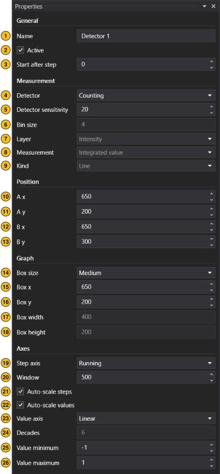

A counting detector: the detections of its line, step by step.

1. **Name**  
   Name shown in the project tree and in the graph title.
2. **Active**  
   Sample and draw this probe.
3. **Start after step**  
   Step at which recording starts; 0 records from the first step.
4. **Detector**  
   A standard probe, or a probabilistic detector: counting, the detections of the whole line step by step over time, as a photomultiplier's pulses; or imaging, the detections at every point of the line added up over the run, as a SPAD array builds an image. A detector is a line probe of the integrated intensity.
5. **Detector sensitivity**  
   Expected detections per unit of intensity per step at a point of the line: the detector's quantum efficiency and the scale from intensity to detections in one number. The detections are Poisson-distributed about intensity × sensitivity; 0 detects nothing.
6. **Bin size**  
   Pixels of the line per bin of an imaging detector's histogram, 1 to 20: the detections of a bin's pixels are added up, and the graph shows the bin's total across them. Wider bins fill faster and show less detail.
7. **Layer**  
   Output the probe samples and is drawn on.
8. **Measurement**  
   Recorded quantity. The field offers its amplitude only; the intensity layer its value, or the value integrated over the run.
9. **Kind**  
   A single point, or a line from A to B.
10. **A x**  
   X of the probe pixel, or of the start of the line, in canvas pixels.
11. **A y**  
   Y of the probe pixel, or of the start of the line, in canvas pixels.
12. **B x**  
   X of the end of the line in canvas pixels; line probes only.
13. **B y**  
   Y of the end of the line in canvas pixels; line probes only.
14. **Box size**  
   Nominal size of the graph box drawn over the output; a box larger than the canvas is shrunk to fit it, aspect kept.
15. **Box x**  
   Left edge of the graph box in canvas pixels. A box placed on the probe's point A moves with the probe; dragging it close snaps it on.
16. **Box y**  
   Top edge of the graph box in canvas pixels. A box placed on the probe's point A moves with the probe; dragging it close snaps it on.
17. **Box width**  
   Width of the graph box in canvas pixels; custom box size only. A box larger than the canvas is shrunk to fit it, aspect kept.
18. **Box height**  
   Height of the graph box in canvas pixels; custom box size only. A box larger than the canvas is shrunk to fit it, aspect kept.
19. **Step axis**  
   Sliding window of the last steps, or the whole run; point probes and counting detectors only.
20. **Window**  
   Width of the sliding step window, in steps.
21. **Auto-scale steps**  
   Let the step axis follow the samples recorded so far; point probes and counting detectors only.
22. **Auto-scale values**  
   Fit the value axis to the data instead of the fixed minimum and maximum.
23. **Value axis**  
   A linear or a logarithmic value axis; intensity probes only, the field is always linear.
24. **Decades**  
   Decades a logarithmic value axis spans below its top; smaller values, zero included, sit on the bottom line.
25. **Value minimum**  
   Lower bound of the value axis when it is not auto-scaled.
26. **Value maximum**  
   Upper bound of the value axis when it is not auto-scaled.

## Imaging detector

An imaging detector: the detections along its line, added up.

1. **Name**  
   Name shown in the project tree and in the graph title.
2. **Active**  
   Sample and draw this probe.
3. **Start after step**  
   Step at which recording starts; 0 records from the first step.
4. **Detector**  
   A standard probe, or a probabilistic detector: counting, the detections of the whole line step by step over time, as a photomultiplier's pulses; or imaging, the detections at every point of the line added up over the run, as a SPAD array builds an image. A detector is a line probe of the integrated intensity.
5. **Detector sensitivity**  
   Expected detections per unit of intensity per step at a point of the line: the detector's quantum efficiency and the scale from intensity to detections in one number. The detections are Poisson-distributed about intensity × sensitivity; 0 detects nothing.
6. **Bin size**  
   Pixels of the line per bin of an imaging detector's histogram, 1 to 20: the detections of a bin's pixels are added up, and the graph shows the bin's total across them. Wider bins fill faster and show less detail.
7. **Layer**  
   Output the probe samples and is drawn on.
8. **Measurement**  
   Recorded quantity. The field offers its amplitude only; the intensity layer its value, or the value integrated over the run.
9. **Kind**  
   A single point, or a line from A to B.
10. **A x**  
   X of the probe pixel, or of the start of the line, in canvas pixels.
11. **A y**  
   Y of the probe pixel, or of the start of the line, in canvas pixels.
12. **B x**  
   X of the end of the line in canvas pixels; line probes only.
13. **B y**  
   Y of the end of the line in canvas pixels; line probes only.
14. **Box size**  
   Nominal size of the graph box drawn over the output; a box larger than the canvas is shrunk to fit it, aspect kept.
15. **Box x**  
   Left edge of the graph box in canvas pixels. A box placed on the probe's point A moves with the probe; dragging it close snaps it on.
16. **Box y**  
   Top edge of the graph box in canvas pixels. A box placed on the probe's point A moves with the probe; dragging it close snaps it on.
17. **Box width**  
   Width of the graph box in canvas pixels; custom box size only. A box larger than the canvas is shrunk to fit it, aspect kept.
18. **Box height**  
   Height of the graph box in canvas pixels; custom box size only. A box larger than the canvas is shrunk to fit it, aspect kept.
19. **Step axis**  
   Sliding window of the last steps, or the whole run; point probes and counting detectors only.
20. **Window**  
   Width of the sliding step window, in steps.
21. **Auto-scale steps**  
   Let the step axis follow the samples recorded so far; point probes and counting detectors only.
22. **Auto-scale values**  
   Fit the value axis to the data instead of the fixed minimum and maximum.
23. **Value axis**  
   A linear or a logarithmic value axis; intensity probes only, the field is always linear.
24. **Decades**  
   Decades a logarithmic value axis spans below its top; smaller values, zero included, sit on the bottom line.
25. **Value minimum**  
   Lower bound of the value axis when it is not auto-scaled.
26. **Value maximum**  
   Upper bound of the value axis when it is not auto-scaled.

## Colour scheme

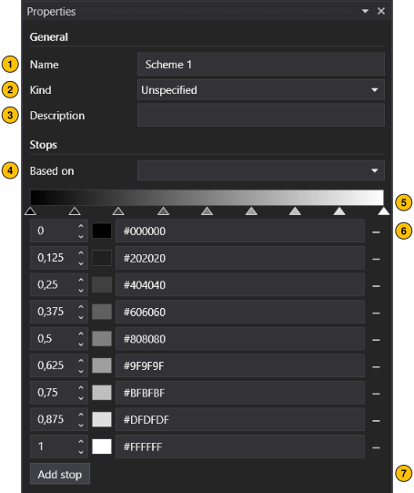

A colour scheme of the project.

1. **Name**  
   Name the display settings refer to.
2. **Kind**  
   Output the scheme is meant for; the pickers list it for that output only.
3. **Description**  
   Free text: what the scheme is, where it comes from.
4. **Based on**  
   Copy the stops of an existing scheme into this one, then change them
5. **A stop: position, colour swatch (opens the picker), hex value, remove**  
   Pick the colour: Space opens the picker, Enter keeps it, Escape puts the old colour back
6. **Add a stop**  
   Insert a stop in the widest gap, with the gradient's colour there

## Settings every part shares

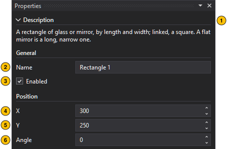

The settings every part shares: the top of every part's form, here the rectangle's.

1. **Description of the kind, opened and closed with Space; one setting for every kind**  
   Show or hide what this kind of part is
2. **Name**  
   Name shown in the project tree and on the canvas.
3. **Enabled**  
   Paint the part into the scene; a disabled part has no effect on a run.
4. **X**  
   X of the part's centre in canvas pixels.
5. **Y**  
   Y of the part's centre in canvas pixels.
6. **Angle**  
   Rotation about the centre in degrees, counter-clockwise on the screen. 0 points the part's axis to the right.

## Glass and mirror settings

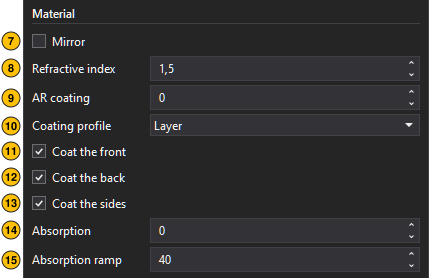

The glass and mirror settings: the Material section of a shape's form, here the rectangle's.

7. **Mirror**  
   Make the part a mirror instead of glass. The refractive index, the coating and the absorption are ignored then.
8. **Refractive index**  
   Refractive index of the glass, 1.00 to 2.55 in steps of 0.01.
9. **AR coating**  
   Thickness in pixels of the anti-reflection band just inside the outline; 0 for none. A quarter-wave layer is λ / (4 √n) pixels thick, λ being the wavelength the source form shows; a graded band is the better the thicker, from a wavelength on.
10. **Coating profile**  
   How the index runs through the band: a layer at √n, the quarter-wave idea, or a graded rise from the medium outside to the glass. A graded band reflects less than a layer once it is a wavelength thick or more, at any wavelength; a layer only at the wavelength it is cut for.
11. **Coat the front**  
   Put the band on the front: the faces turned toward a source on the left, a lens's first surface. Clear it to leave them bare, as the inner faces of a cavity are.
12. **Coat the back**  
   Put the band on the back: the faces turned away from a source on the left, a lens's second surface. Clear it to leave them bare.
13. **Coat the sides**  
   Put the band on the sides: the faces that are neither front nor back, a lens's rim, a slab's narrow ends. Clear it to leave them bare.
14. **Absorption**  
   How strongly the part absorbs waves, 0 (not at all) to 255, as the scene image's blue channel. It rises from nothing at the outline over the absorption ramp, so a wave enters the part instead of being reflected. A mirror ignores it.
15. **Absorption ramp**  
   Depth in pixels over which the absorption rises from nothing at the outline to its full value; the longer, the less of a wave is reflected. A part thinner than twice the ramp reaches its full absorption in its middle.

