# WaveDude Next manual

<!-- The figures are drawn by _tools/ui_check/Screenshots.ps1 from the example projects; the numbers in the lists are the badges of the figure above them. -->

WaveDude Next simulates waves on a two-dimensional canvas. You place sources, put lenses, mirrors, fibres and other optical parts in their way, and watch the wave field and the intensity build up frame by frame. Probes measure the wave at a point or along a line, and a finished run can be exported as a video, as an image sequence or as raw data.

For a first impression, open one of the projects under File > Examples and press Play (Space). The pictures follow the run while it is computed; drag the playhead on the timeline to look at any frame, and change a source or a part to see the run start over with your change.

This manual is also in the program: Help > Manual or F1 opens it, the contents on the left take you to a section, Esc closes it.

## The main window

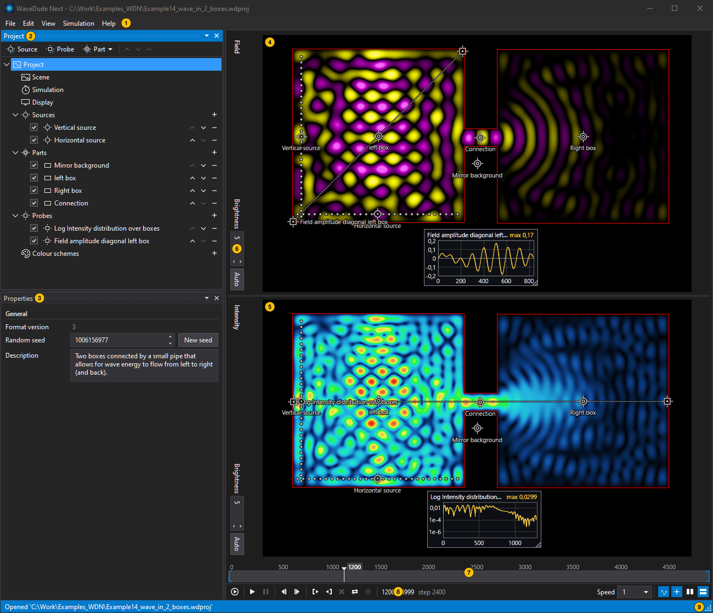

The main window with an example project at frame 1200.

1. **Menu bar**: The File, Edit, View, Simulation and Help menus; see [The menus](#the-menus). Press F10 or Alt to use them from the keyboard.
2. **Project pane**: The tree of everything in the project: the scene and the settings at the top, then the sources, the optical parts, the probes and the colour schemes. Click a row to edit it; see [The project tree](#the-project-tree).
3. **Properties pane**: The form of the selected object. Hover over a box for a short explanation of the setting.
4. **Field picture**: The wave field at the frame shown: the displacement of the wave at every pixel, positive and negative in the colours of the field's colour scheme.
5. **Intensity picture**: The intensity: the wave's energy averaged over the last steps, so it shows where the light goes, much as a long exposure would.
6. **Header strip of a picture**: The title, the brightness box and Auto, which fits the brightness to the frame shown; see [The preview](#the-preview).
7. **Timeline**: Your position in the run. Click or drag to scrub; drag a bracket to move the start or end of the export range. Left/Right step a frame, PageUp/PageDown ten, Home/End jump to the start/end of the range. See [The timeline](#the-timeline).
8. **Transport controls**: Run, play and pause, frame steps, the in and out points, loop and live, the position as frame and step, the playback speed, and which pictures are shown and how.
9. **Status bar**: Shows the last entry in the log. Double-click opens the Messages pane. Colour changes for warnings and errors.

The panes can be arranged as you like: drag a pane by its title to another side of the window, or use the controls at the right of its title to move or close it; View > Panes brings a closed pane back. The arrangement is kept for the next start, as are the theme, the language and the preview settings of the View menu.

Everything can be done from the keyboard: Tab moves through the controls of the panes and the handles on the pictures, the arrow keys move within the tree and along the timeline and nudge a handle, and every menu entry shows its shortcut.

### The project tree

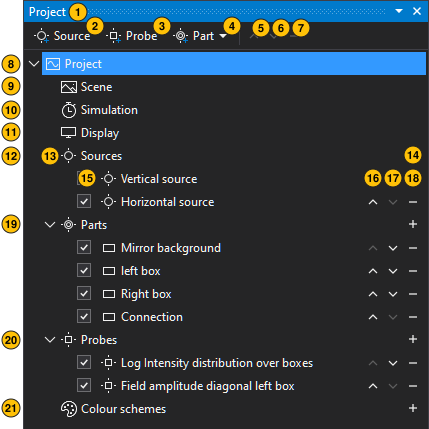

The Project pane with the example project.

1. **Pane title**: You can reposition the pane by dragging it. The controls on the right allow you to move or close the pane.
2. **Add a source**: Add a source to the project. It lands at the centre of the canvas shown; drag it from there or type its position. See [Sources](#sources).
3. **Add a probe**: Add a probe to the project, at the centre of the canvas as well. See [Probes](#probes).
4. **Add a part**: Shows a submenu of possible optical parts to add to the project. See [Optical parts](#optical-parts).
5. **Move the selected object up**: Move up (Alt+Up). Rows can also be dragged to reorder them.
6. **Move the selected object down**: Move down (Alt+Down).
7. **Remove the selected object**: Remove (Del).
8. **Project**: The root of the current project. Its form holds the random seed and a description; see [Project settings](#project-settings).
9. **Scene**: Configure scene properties, such as the size, the edge configuration and damping, the overall refractive index, and scene sources.
10. **Simulation**: Configure simulation properties, such as the length of the simulation to run and the wave speed.
11. **Display**: Configure various properties of the appearance of the preview, the simulation render and export.
12. **Sources**: Sources emit waves of a specified wavelength and amplitude. The group holds every source of the project.
13. **Expand and collapse tree groups**: The chevron opens or closes a group.
14. **Add to this group**: Adds a new item to the group, the same as the buttons above.
15. **Enabled**: Includes the object in runs: a source emits, a part is painted into the scene, a probe measures. Space on the row toggles it; a disabled object stays in the project, greyed.
16. **Move up**: Moves the row up within its group (Alt+Up).
17. **Move down**: Moves the row down (Alt+Down).
18. **Remove**: Removes the object (Del).
19. **Parts group**: The optical parts: lenses and mirrors, shapes, fibres, Bragg reflectors, GRIN lenses, zone plates and logic gates, all painted into the scene.
20. **Probes group**: The probes, which measure the field or the intensity at a point or along a line and draw a graph over the pictures.
21. **Colour schemes group**: The colour schemes kept in this project; the Display settings pick one for each picture. See [Colour schemes](#colour-schemes).

You can select several rows: Ctrl+click adds a row or removes it (Insert or Ctrl+Space does the same for the focused row), Shift+click or Shift with the arrow keys selects a range, Ctrl+A selects everything. Remove, Duplicate and Enabled then act on the whole selection, and dragging one of the selected handles on the pictures moves them all together.

The row's context menu has the same commands as the buttons and more: Add source, Add part and Add probe; Add to or remove from selection and Select all; Enabled, Duplicate (Ctrl+D), Cut, Copy, Paste and Remove; Move up and Move down; and on a probe, Export probe data as CSV.

Objects can be dragged: drag a row within its group to reorder, onto a picture to put a copy where you drop it, or into the tree of another WaveDude Next window to copy it there. Cut, copy and paste (Ctrl+X, Ctrl+C, Ctrl+V) work on objects too, and the clipboard holds them as text, so a source can be pasted into a text editor and back. A pasted object lands behind the selected row and is renamed only when its name is already taken. A project file dropped anywhere on the window opens it.

Every change can be undone (Ctrl+Z) and redone (Ctrl+Y or Ctrl+Shift+Z) without limit, moves on the pictures included; a text box keeps its own undo while you type in it.

### The preview

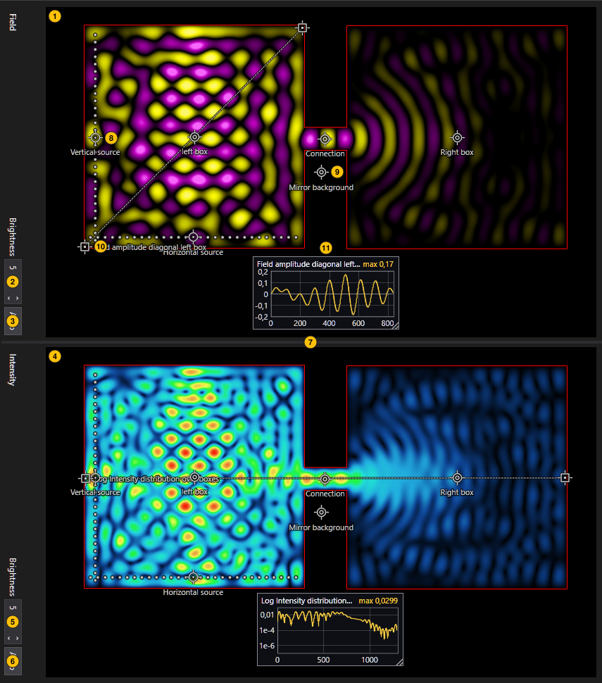

The preview: the field and intensity pictures of the example project at frame 1200.

1. **Field picture**: The field at the frame shown. The pictures are scaled to fit the pane. A thin line around a picture shows what a wave meets at the edge of the canvas: red for a reflecting wall, blue for a damping rim outside the canvas, nothing for an open edge.
2. **Brightness of the field picture**: How bright the field is drawn: a factor on the values before they are coloured. Type a number, or step it with the keys: Up and Down by two percent, PageUp and PageDown by a fifth.
3. **Auto brightness**: Fits the brightness once to the frame shown: the brightest half percent of it reaches the top of the colour scheme. The brightness then stays as it is.
4. **Intensity picture**: The intensity at the frame shown.
5. **Brightness of the intensity picture**: The same for the intensity.
6. **Auto brightness of the intensity picture**: The same for the intensity.
7. **Splitter between the pictures**: Drag or use the arrow keys to resize; double-click or Enter resets to half.
8. **Source handle**: A source on the pictures, here the one named Vertical source. Drag the handle to move the source; with the keyboard focus the arrow keys move it by a pixel, ten with Shift. A composite source also shows its emitters as dots and a lever to turn the array; Shift snaps it to 15 degrees.
9. **Part handle**: A part, here the mirror named Mirror background. Drag to move it, the arrow keys nudge it. A selected part also shows a lever for its angle and, by its kind, grips to resize it, the two surface handles of a lens, the points of an outline or the nodes and handles of a fibre, all of them draggable and reachable with Tab.
10. **Probe handle**: A probe, here the end A of a line probe. Drag to move it, the arrow keys nudge it. A probe appears on the picture of the layer it measures, a source on both.
11. **Probe graph box**: The graph of a probe over the picture. Drag it to move it, drag its corner to resize it; with the keyboard focus the arrow keys move it by a pixel, ten with Shift. A box left on the probe's point moves with the probe.

Click a handle to select its object; the tree and the Properties pane follow. Click on empty space to deselect, or drag there to select everything inside the rectangle, Shift adding to the selection and Ctrl toggling it; Ctrl+click adds or removes a single object. Del removes the selected objects. Esc during a drag puts everything back where it was. The Display settings have Handles in the preview and Labels in the preview, which hide the handles or the names of everything but the selected object.

A picture changes only when a frame for your position is ready; until then the last picture stays. When you edit the scene, a source or a part, the frame you are on is computed afresh with your change and shown as soon as it is ready, and a new run starts by itself a moment after your last change (Simulation > Re-run automatically after edits). A long wait dims the pictures under a spinner. Moving a probe or changing its graph needs no new run.

Right-click a picture for Brightness, Auto brightness, Export this frame and the exports of the run; see [Export](#export).

### The timeline

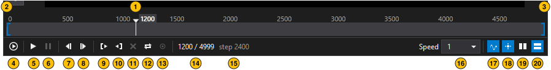

The timeline with the playhead and the in and out points, and the transport controls.

1. **Playhead**: The position shown. Drag it, or click anywhere on the timeline to jump there.
2. **In point**: The start of the export range; drag the bracket to move it.
3. **Out point**: The end of the export range.
4. **Run the simulation**: Runs the simulation from the start (F5): every frame of the project as it is now. The pictures follow the run while it computes.
5. **Play**: Plays the frames at the playback speed (Space). When there is no run yet, or the project has changed since the last one, Play starts a run and follows it.
6. **Pause**: Pauses playback (Space).
7. **One frame back**: Previous frame (,).
8. **One frame forward**: Next frame (.).
9. **Set the in point**: Starts the export range at this frame (I).
10. **Set the out point**: Ends the export range at this frame (O).
11. **Clear the in and out points**: Clears the export range: the whole run is exported (X).
12. **Loop**: Loops playback over the export range (L).
13. **Live**: Follows the newest frame while the run is in progress (F); scrubbing ends it.
14. **Position**: The frame shown and the last frame of the run.
15. **Step of the position**: The simulation step of the frame shown. A frame is kept every so many steps, as set by Visualize every in the Simulation settings.
16. **Playback speed**: Pick a factor or type one.
17. **Show the field**: Shows or hides the field picture.
18. **Show the intensity**: Shows or hides the intensity picture.
19. **Pictures side by side**: Field and intensity side by side.
20. **Pictures stacked**: Field above intensity.

The letter shortcuts work while the preview pane has the focus. The in and out points are the From step and To step of the Display settings, so they are saved with the project; the range is what File > Export writes and what Loop plays.

## The menus

The menu bar holds the File, Edit, View, Simulation and Help menus. Press F10 or Alt to open them from the keyboard; the entries show their shortcuts. The Add part menu of the project tree is described with the [optical parts](#optical-parts).

### The File menu

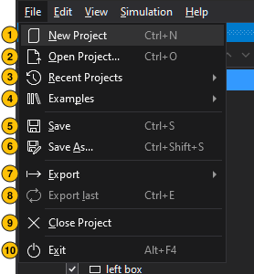

The File menu.

1. **New Project**: Starts a new, empty project (Ctrl+N): a blank canvas with open edges and a damping rim around it, no sources yet.
2. **Open Project...**: Opens a project file (Ctrl+O): a WaveDude Next project (.wdproj), or a configuration.json of Wave Dude 2D, which is imported.
3. **Recent Projects**: The projects you opened last.
4. **Examples**: The example projects shipped with the program; see [Examples](#examples).
5. **Save**: Saves the project (Ctrl+S). The scene image is embedded in the file, so a project is one file.
6. **Save As...**: Saves the project under a new name (Ctrl+Shift+S).
7. **Export**: Videos, image sequences and data of the run; see [Export](#export).
8. **Export last**: Repeats the last export of a run in this session (Ctrl+E): the same pictures, format and file, without a dialog; an existing file is replaced.
9. **Close Project**: Closes the project; unsaved changes are asked about first.
10. **Exit**: Quits the program (Alt+F4); unsaved changes are asked about first.

#### Export

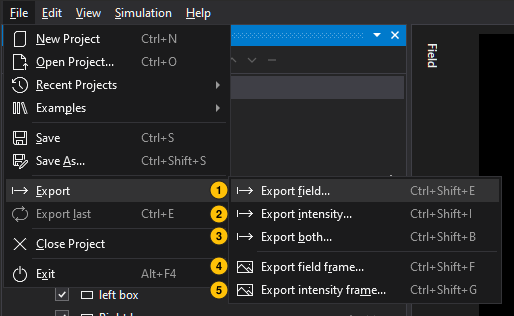

The File > Export submenu.

1. **Export field...**: Writes the field over the export range (Ctrl+Shift+E) as a video or an image sequence.
2. **Export intensity...**: The same for the intensity (Ctrl+Shift+I).
3. **Export both...**: Both at once (Ctrl+Shift+B): two files, the field's and the intensity's, from one name.
4. **Export field frame...**: Writes the frame shown as one image of the field (Ctrl+Shift+F).
5. **Export intensity frame...**: The same for the intensity (Ctrl+Shift+G).

The file type in the Save dialog picks the format: an MP4 video (H.264), an MPEG-1 video, an uncompressed AVI, a QuickTime movie with the lossless Animation codec or the lossless PNG codec, a PNG or JPEG image sequence (one file per frame in a folder, numbered by the frame), or an OpenEXR sequence with the raw data: one 16-bit float channel per file, no colours, the intensity either as I or as √I, for NumPy, MATLAB, Octave or a viewer such as DJV. A frame export offers PNG, JPEG and the two OpenEXR kinds. JPEG is written with full colour resolution (4:4:4), so the fringes of a wave stay sharp.

What the pictures contain is set in the Display settings: the colour scheme, brightness and black level of each layer, the outline of the scene image, the probes' graphs and markers, the source markers, the frame rate and the quality of a video; see [Display](#display). An export always uses the full quality: when the preview was computed at a reduced resolution, with skipped frames or with 8-bit samples (View menu), the run is made again at full quality first. The dialog starts in the project's folder under the project's name, and after the first export where the last one went.

A probe's measurements are exported as CSV from the probe's context menu, in the tree or on its graph box; see [Probes](#probes).

#### Examples

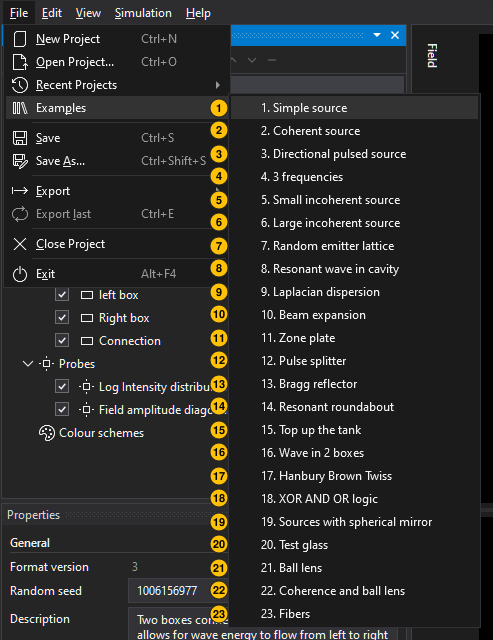

The File > Examples submenu: the example projects shipped with the program, most of them from Wave Dude 2D. Each opens as an unsaved project named after its example; save it under your own name to keep your changes. Hover over an entry for its description.

1. **Source Mirror Probe**: Simple omnidirectional pulsed source with a smoothed square intensity profile, reflecting of simple mirror surface. A probe measures the intensity profile near the surface.
2. **Coherent source gaussian beam**: Featuring a 21 x 7 composite source that emits a continuous gaussian beam
3. **Directional pulsed source**: Featuring a coherent pulsed assembly of sources that emits a directional stream of wave pulses.
4. **3 sources 3 frequencies**: Geometric wave pattern resulting from 3 sources with different frequencies
5. **Small incoherent source**: Simulation features a small (5x5 composite) source using randomized "off"-time and source frequency.
6. **Large incoherent source**: Featuring a large (450+ composite) source that creates both spatially- as well as temporally incoherent wave emission. The probes show that even though the intensity variations are large for an incoherent source, they eventually average out over time. Probe 2 shows the 1/r relationship. where r= distance to the source.
7. **Random emitter lattice**: Collection of 800+ sources distributed over the full animation space and emitting short random wave pulses with a varying frequency.
8. **Resonant wave in cavity**: Wave energy released at the center of a cavity at almost the resonance frequency.
9. **Laplacian dispersion**: Visualization of dispersion (wavelength-dependent propagation speed) when using a third order Laplacian. To remove the dispersion, check the 4th order Laplacian checkbox under "Simulation".
10. **Beam expansion**: A beam expander using a GRIN lens and a large confocal lens.
11. **Zone plate**: One source and a zone plate
12. **Pulse splitter**: Short coherent pulse divided by a beam splitter
13. **Bragg reflector**: Demo of a Bragg reflector. The layer thickness of each layer should be 1/4 lambda divided by the refractive index of the specific layer. However, reflectivity is strongly angle dependent.
14. **Resonant roundabout**: Resonant roundabout with two sources and two exits. If you change the phase of one of the sources by 180 degrees, waves will take the other exit.
15. **Top up the tank**: Filling a tank with radiative energy
16. **Wave in 2 boxes**: Two boxes connected by a small pipe that allows for wave energy to flow from left to right (and back).
17. **Hanbury Brown Twiss**: Switch on the small source and the two telescopes will see highly correlated signals. Switch on the large source and the correlation disappears. This is a demonstration of the area of coherence as can be measured in the HBT experiment to measure the ratio between the diameter and the distance of a star.
18. **XOR AND OR logic**: 3 logical wave gates chained together
19. **Sources with spherical mirror**: Wave pulse emitted from the center of the curvature of a mirror, reflecting and then returning to the point of emission. Featuring timed probes. Notice that this simulation runs extremely fast on the GPU, when no video export is selected.
20. **Test glass**: The simulation shows the interference pattern created between two high-refractive index surfaces in close proximity of each other under a small angle.
21. **Ball lens**: Continuous point source and high refractive index ball lens. Probe 2A-B features 1/r intensity decay from the source with some interference of some reflections superimposed on it.
22. **Coherence and ball lens**: A coherent and directional source directing its waves at a ball lens with a high refractive index. It demonstrates Gaussian beam and Airy disk profiles
23. **Fibers**: Simulation of 3 different fibers: top a single mode fiber, middle a narrow multi-mode fiber, bottom a wide multi-mode fiber. Includes the use of two probes, an A-B (line) field probe and a single point intensity probe.
24. **Fiber cross over**: Two single-mode fibres side by side, their cores a dozen pixels apart: the evanescent field of one reaches into the other, so light launched into fibre A crosses over into fibre B and back along the length, a directional coupler. The probe along A shows the beating, the cross-fibre probe the field across both cores. Switch source A off and B on to launch from the other fibre.

### The Edit menu

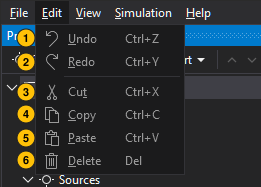

The Edit menu.

1. **Undo**: Takes the last change back (Ctrl+Z), without limit.
2. **Redo**: Does it again (Ctrl+Y or Ctrl+Shift+Z).
3. **Cut**: Cuts the selected objects to the clipboard (Ctrl+X).
4. **Copy**: Copies them (Ctrl+C), as text in the project's own format, so they can go into a text editor or another window as well.
5. **Paste**: Pastes objects behind the selected row (Ctrl+V); a copied Scene, Simulation or Display settings object replaces the project's when pasted on its row or on the project.
6. **Delete**: Removes the selected objects (Del).

### The View menu

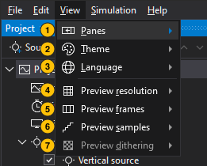

The View menu. Its settings belong to the program, not to the project, and are kept between sessions.

1. **Panes**: Shows or hides the Project, Properties, Preview and Messages panes. The Messages pane lists the program's log with a search box, a filter per level and Copy for a bug report.
2. **Theme**: System, Light or Dark; System follows Windows.
3. **Language**: System, English, Deutsch, Français or Nederlands; the program switches at once.
4. **Preview resolution**: Full, Half or Quarter: the preview's run computes the canvas at a reduced size, faster and with less memory, for a weaker machine. An export always uses the full size.
5. **Preview frames**: Full, every second or every fourth frame kept by the preview's run; the timeline does not change.
6. **Preview samples**: 16-bit float keeps the full values, so the brightness can be changed after a run and every level of a gradient shows; 8-bit palette index stores each pixel as its colour at the brightness of the run's start, half the memory, and a brightness change then needs a new run, which starts by itself.
7. **Preview dithering**: With 16-bit samples, the pictures can be dithered as if the screen had 10, 12, 14 or 16 bits per channel, which hides the banding of dark gradients; on screen only, never in an export. Off by default, except on a machine with plenty of memory (see below).

On its first start the program chooses the preview resolution, the preview frames, the preview samples and the dithering for the machine it runs on, once, and the View menu shows the choice. A machine with 32 GB of memory or more starts with 16-bit samples, dithered to 16 bits. A machine with less than 16 GB, with a hard disk under the cache file, without an OpenCL graphics card or with four processor threads or fewer starts at half resolution with every second frame and 8-bit samples. Every other machine starts at full resolution with every frame and 8-bit samples. Each setting can be changed here at any time.

### The Simulation menu

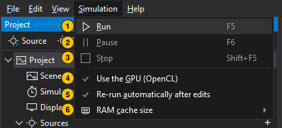

The Simulation menu.

1. **Run**: Runs the simulation from the start (F5).
2. **Pause**: Pauses the run, and resumes it (F6).
3. **Stop**: Stops the run (Shift+F5); the frames computed so far stay.
4. **Use the GPU (OpenCL)**: Computes on the graphics card, many times faster than the processor; the results are the same. Off, or without OpenCL, the processor is used. On by default.
5. **Re-run automatically after edits**: Starts a new run by itself a moment after you change the scene, a source or a part; off, you run by hand with F5 or Play. On by default.
6. **RAM cache size**: How much of the memory a run's frames may take: Auto decides from the free memory, or a share from 10 to 100 percent caps it; the frames beyond it go to a cache file on disk.

### The Help menu

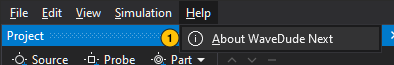

The Help menu.

1. **About WaveDude Next**: The version, the people whose work it is based on, the license, and the system information (processor, memory, OpenCL devices, video encoders) with a button that copies it for a bug report.
2. **Manual**: This manual (F1). F1 brings it to the front again, Esc closes it, and it closes with the main window.

## Project settings

The first rows of the project tree are the settings of the project as a whole: the Project row with the random seed and a description, the Scene (the canvas and what it is made of), the Simulation (how long and how precisely it runs) and the Display (how the pictures are coloured and what an export contains). A project is saved as one .wdproj file, the scene image embedded; the settings of the View and Simulation menus are the program's and are not in it.

### Project

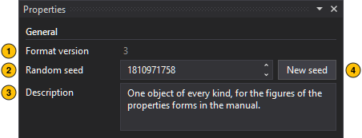

The project's own form.

1. **Format version**: The version of the project file format; older files are read and saved in the current one.
2. **Random seed**: The seed of every random decision in the project, the emitters' random offsets and the random gaps between bursts; the same seed reproduces the same frames.
3. **Description**: Free-text notes about the project. An example's description is what its menu entry shows.
4. **New seed**: Draws a fresh random seed.

### Scene

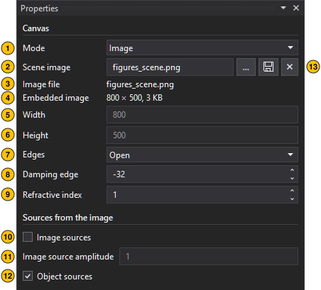

The Scene form of a project with a scene image. The canvas is either blank, with its size and a uniform refractive index, or built from an image, in which every pixel's red is the refractive index (red 0 a mirror), green an emitting source and blue absorption; optical parts are painted over either.

1. **Mode**: Blank canvas of the given size, or a canvas built from the scene image.
2. **Scene image**: Image the canvas is built from: red = refractive index (red 0 = a mirror), green = sources, blue = damping. The name of the embedded image, or a path relative to the project folder.
3. **Image file**: Where the embedded image came from. The embedded image is what is simulated, so a missing file changes nothing; while the project is open, the file is watched and re-embedded when it changes, and on opening the project a changed file replaces the embedded image too.
4. **Embedded image**: The size of the embedded scene image; the canvas takes this size.
5. **Width**: Width of a blank canvas in pixels.
6. **Height**: Height of a blank canvas in pixels.
7. **Edges**: Open lets a wave leave the canvas, as if it sat in open space; Reflective is a hard wall, as in Wave Dude 2D.
8. **Damping edge**: Thickness in pixels of the absorbing frame: positive inside the canvas, where it shows as a dark margin; negative outside it, simulated but never shown. 0 turns it off. A new project has open edges with a rim outside, the combination that returns the least.
9. **Refractive index**: Refractive index of a blank canvas, 1.0 to 2.55; the wave speed is 1/n pixels per step.
10. **Image sources**: Lets the green channel of the scene image emit waves; the pixel value is the frequency level.
11. **Image source amplitude**: Peak amplitude of the image sources.
12. **Object sources**: Uses the sources defined in the project.
13. **The image buttons**: The dots pick an image file (PNG, BMP, JPEG, TIFF or GIF), which is embedded in the project; the save glyph writes the embedded image out to a file; the X drops the image and its path, leaving a blank canvas of the image's size.

### Simulation

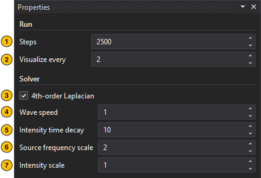

The Simulation form.

1. **Steps**: Total number of simulation steps in a run.
2. **Visualize every**: A frame is kept, exported and the probes are sampled every this many steps.
3. **4th-order Laplacian**: Uses the more accurate 4th-order stencil with sub-stepping instead of the 9-point stencil. Slower; it removes the dispersion of the 9-point stencil, where the speed depends on the wavelength.
4. **Wave speed**: Nominal wave speed in pixels per step; only used to estimate wavelengths in the forms.
5. **Intensity time decay**: How long the intensity remembers: it is averaged over this × 100 / lowest source level steps.
6. **Source frequency scale**: Multiplier of the level-to-frequency mapping: ω = level / 255 × 0.5 × scale, in radians per step.
7. **Intensity scale**: Multiplier applied to the intensity values.

### Display

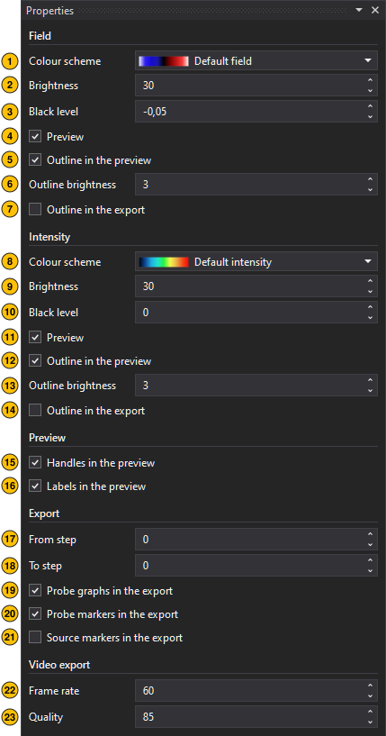

The Display form: the Field and Intensity sections colour the two pictures, Preview sets what lies over them, Export what a video or image sequence contains.

1. **Colour scheme**: The colour scheme of the field picture; see [Colour schemes](#colour-schemes).
2. **Brightness**: Gain applied to the values before the colour lookup; the same as the box in the picture's header.
3. **Black level**: Offset applied before the colour lookup; values at or below it map to the first colour.
4. **Preview**: Shows the field in the preview.
5. **Outline in the preview**: Lays the scene image's glowing-edges outline over the field picture, so you see the scene in the wave.
6. **Outline brightness**: Multiplier of the outline: 1 as computed, higher lifts faint edges, 0 hides it.
7. **Outline in the export**: Bakes the outline into exported frames and videos of the field.
8. **Colour scheme**: The same for the intensity picture.
9. **Brightness**: The same for the intensity.
10. **Black level**: The same for the intensity.
11. **Preview**: Shows the intensity in the preview.
12. **Outline in the preview**: The outline over the intensity picture.
13. **Outline brightness**: The same for the intensity.
14. **Outline in the export**: The same for the intensity.
15. **Handles in the preview**: Shows the handles, lines, emitter dots and levers of every source, part and probe over the preview pictures. A selected object shows its own either way.
16. **Labels in the preview**: Shows the names beside the handles over the preview pictures. A selected object shows its own either way.
17. **From step**: First simulation step of the exported range; 0 is the start of the run. The in point of the timeline.
18. **To step**: Last simulation step of the exported range; 0 means the end of the run. The out point of the timeline.
19. **Probe graphs in the export**: Draws the probes' graph boxes over exported frames and videos.
20. **Probe markers in the export**: Draws the probes' positions (crosses, the line of a line probe, the number) over exported frames and videos.
21. **Source markers in the export**: Draws the enabled sources (the marker, a composite source's emitter dots, the name) over exported frames and videos.
22. **Frame rate**: Frames per second of an exported video.
23. **Quality**: Encoder quality, 1 to 100.

## Sources

Sources emit the waves. A point source emits from one pixel; a composite source is an array of emitters around its position, which makes a beam, a directional pulse or an incoherent patch, as the examples show. Add a source with the first button of the project tree or its context menu; it lands at the centre of the canvas, and you move it by its handle on the pictures or by typing X and Y. A source's frequency is a level up to 255 on the scale of the scene image's green channel; the form shows the wavelength it gives in pixels. A source emits continuously or in bursts, and a disabled source is left out of a run.

### Source

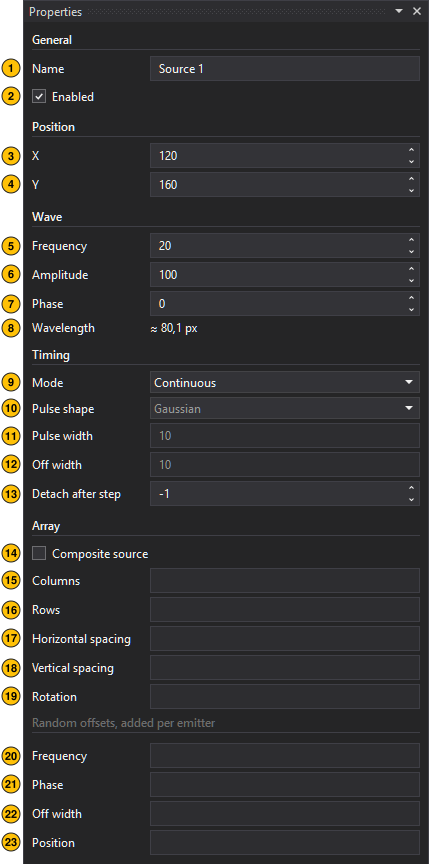

The form of a point source.

1. **Name**: Name shown in the project tree and on the canvas.
2. **Enabled**: Includes the source in simulation runs.
3. **X**: Horizontal position of the emitter, or of the array centre, in canvas pixels.
4. **Y**: Vertical position of the emitter, or of the array centre, in canvas pixels.
5. **Frequency**: Frequency as a level up to 255, decimals allowed, the same scale as the green channel of image sources. Above 255 the grid cannot sample the wave.
6. **Amplitude**: Amplitude in percent, 0 to 100, decimals allowed.
7. **Phase**: Phase offset in degrees, -180 to 180.
8. **Wavelength**: Estimated from the wave speed and the frequency (λ = c / f): emitters one wavelength apart radiate in phase along that direction. Holds for the 4th-order Laplacian; the 9-point stencil's speed varies with the frequency.
9. **Mode**: Emit continuously or in bursts.
10. **Pulse shape**: Envelope of each burst, Gaussian or a smoothed square; pulsed mode only.
11. **Pulse width**: Length of each burst in cycles of the source frequency; pulsed mode only.
12. **Off width**: Length of the gap between bursts in cycles; pulsed mode only.
13. **Detach after step**: Simulation step at which the source fades out; -1 keeps it on for the whole run.
14. **Composite source**: Emits from an array of emitters instead of a single point; the settings below shape the array.
15. **Columns**: Number of emitters across. Odd counts keep the centre emitter on the source position.
16. **Rows**: Number of emitters down.
17. **Horizontal spacing**: Distance between neighbouring columns in canvas pixels.
18. **Vertical spacing**: Distance between neighbouring rows in canvas pixels.
19. **Rotation**: Rotation of the grid about the source position in degrees, counter-clockwise on the screen; 0 keeps the rows horizontal. On the pictures, the lever of a selected composite source turns it.
20. **Frequency**: Random offsets, added per emitter: each emitter's level is offset by up to ± this amount. 0 turns it off.
21. **Phase**: Each emitter's phase is offset by up to ± this many degrees. 0 turns it off.
22. **Off width**: Each gap between bursts is offset by up to ± this many cycles, re-drawn every period. 0 turns it off.
23. **Position**: Each emitter is moved by up to ± this many pixels in X and in Y. 0 turns it off.

The random offsets are drawn from the project's random seed, so a run repeats exactly; New seed on the Project form draws others.

### Composite source

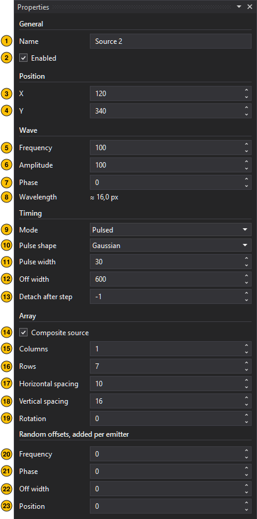

The same form for a composite source in pulsed mode: the pulse settings 10 to 12 are in use, and the array settings 14 to 23 shape the emitters, which the pictures show as dots. The random offsets make an incoherent source: with random off widths the emitters fire out of step, and with random frequencies and phases the pattern changes all the time, as in the examples of the small and the large incoherent source.

## Optical parts

Optical parts are painted into the scene: a part of glass by its refractive index, a mirror reflecting everything, an absorber taking the wave in. Add one from the Add part menu of the project tree; it lands at the centre of the canvas, and you move it by its handle, turn it by its lever and, by its kind, resize it by grips, curve a lens by its surface handles or shape an outline or a fibre by its points. A part edit shows in the pictures as soon as the frame is computed, and the run starts over by itself. At the top of a part's form, a header shows or hides a description of its kind; it stays open or closed for every kind.

### The kinds of parts

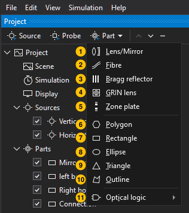

The Add part menu of the project tree.

1. **Lens/Mirror**: A lens or a mirror: a strip of the diameter between two spherical surfaces, each bulging outward, flat or hollow by the sign of its radius, the centre thickness apart. As a mirror it reflects everything; as a lens it refracts by its index, with an anti-reflection coating and absorption if wanted.
2. **Fibre**: A fibre: a core of higher index inside a cladding, along a smooth path of Bézier segments through its nodes, with flat or round ends. A wave coupled into the core is guided along the path; the cladding can absorb stray light at its rim.
3. **Bragg reflector**: A Bragg reflector: pairs of layers of two indices stacked along the axis. It reflects strongly around the wavelength the layer thicknesses are tuned to, a quarter wave each, and passes others.
4. **GRIN lens**: A gradient-index lens: a rectangle whose index falls from the axis to the edge in a parabolic profile, so it focuses like a lens with flat faces.
5. **Zone plate**: A zone plate: Fresnel zones cut for a design frequency and a focal length, every second zone an absorbing block, the central zone open or, inverted, a block. It focuses by diffraction; an optional mount stops light passing outside the diameter.
6. **Polygon**: A regular polygon of glass or mirror, by its number of sides and the side length.
7. **Rectangle**: A rectangle of glass or mirror, by length and width; linked, a square. A flat mirror is a long, narrow one.
8. **Ellipse**: An ellipse of glass or mirror, by the length and width of its box; linked, a circle.
9. **Triangle**: A triangle of glass or mirror: the base across the axis, the apex along it, the base angles set by a preset or by hand.
10. **Outline**: A free outline of glass or mirror: a closed shape through the points you place and drag; fewer than three paint nothing.
11. **Optical logic**: The gates, in a submenu of their own.

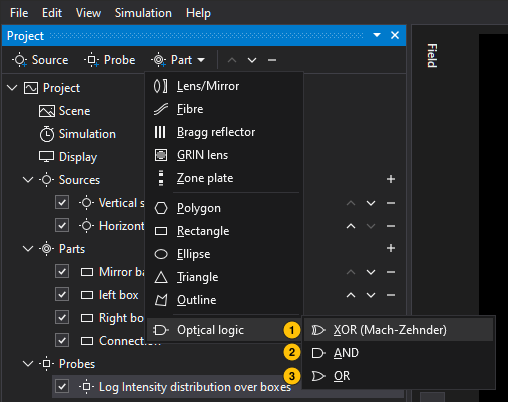

The Optical logic submenu.

1. **XOR (Mach-Zehnder)**: An optical XOR gate: two input waveguides, a phase section putting the lower input a quarter period ahead, and a coupler whose upper output carries their difference. It lights when one input is lit, not both, for coherent inputs at the design frequency.
2. **AND**: An optical AND gate: the same coupler with the lower input a quarter period behind, so the upper output carries the sum. It is brightest with both inputs lit, about four times a single one; a passive linear gate has no truer AND.
3. **OR**: An optical OR gate: the same coupler with the lower input a twelfth of a period ahead, so the upper output carries half the power of either input and of both. It lights with one input or both.

### Settings every part shares

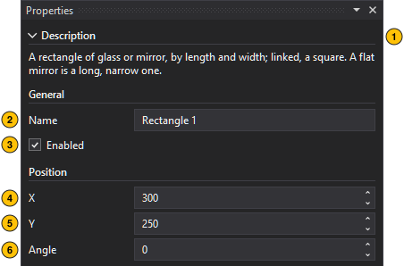

Every part's form starts with the same six settings, here at the top of the rectangle's form; they are the badges 1 to 6 on every part's figure below.

1. **Description of the kind**: The header shows or hides what this kind of part is; Space toggles it. Open or closed is one setting for every kind.
2. **Name**: Name shown in the project tree and on the canvas.
3. **Enabled**: Paints the part into the scene; a disabled part has no effect on a run.
4. **X**: Horizontal position of the part's centre in canvas pixels.
5. **Y**: Vertical position of the part's centre in canvas pixels.
6. **Angle**: Rotation about the centre in degrees, counter-clockwise on the screen; 0 points the part's axis to the right, so the front of the part faces a source on the left.

### Glass and mirror settings

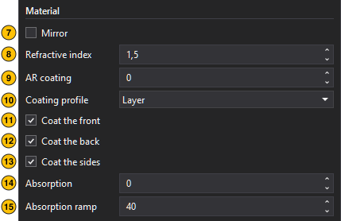

A lens, a polygon, a rectangle, an ellipse, a triangle and an outline are made of glass or are a mirror, and share the material settings, here the Material section of the rectangle's form: the badges 7 to 15 on their figures below. The GRIN lens has the coating settings as well, at 9 to 13 on its form, and the fibre has its own at 13 to 17.

7. **Mirror**: Makes the part a mirror instead of glass. The refractive index, the coating and the absorption are ignored then.
8. **Refractive index**: Refractive index of the glass, 1.00 to 2.55 in steps of 0.01.
9. **AR coating**: Thickness in pixels of the anti-reflection band just inside the outline; 0 for none. A quarter-wave layer is λ / (4 √n) pixels thick, λ being the wavelength the source form shows; a graded band is the better the thicker, from a wavelength on.
10. **Coating profile**: How the index runs through the band: a layer at √n, the quarter-wave idea, or a graded rise from the medium outside to the glass. A graded band reflects less than a layer once it is a wavelength thick or more, at any wavelength; a layer only at the wavelength it is cut for.
11. **Coat the front**: Puts the band on the front: the faces turned toward a source on the left, a lens's first surface. Clear it to leave them bare, as the inner faces of a cavity are.
12. **Coat the back**: Puts the band on the back: the faces turned away from a source on the left, a lens's second surface. Clear it to leave them bare.
13. **Coat the sides**: Puts the band on the sides: the faces that are neither front nor back, a lens's rim, a slab's narrow ends. Clear it to leave them bare.
14. **Absorption**: How strongly the part absorbs waves, 0 (not at all) to 255, as the scene image's blue channel. It rises from nothing at the outline over the absorption ramp, so a wave enters the part instead of being reflected. A mirror ignores it.
15. **Absorption ramp**: Depth in pixels over which the absorption rises from nothing at the outline to its full value; the longer, the less of a wave is reflected. A part thinner than twice the ramp reaches its full absorption in its middle.

### Lens

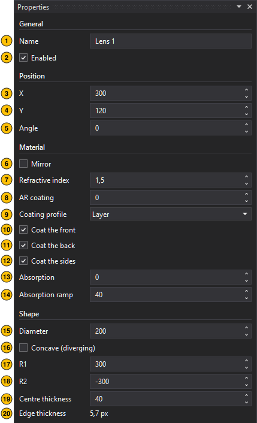

A lens or a mirror: a strip of the diameter between two spherical surfaces, each bulging outward, flat or hollow by the sign of its radius, the centre thickness apart. As a mirror it reflects everything; as a lens it refracts by its index, with an anti-reflection coating and absorption if wanted. Ticking Mirror renames a part called Lens to Mirror, and back. On the pictures, a selected lens shows a handle on each surface: drag it along the axis to curve the surface, outward bulges, inward flattens and then hollows it, while the rim stays. Badges 1 to 15 are the shared and the glass and mirror settings.

16. **Diameter**: Extent across the axis in pixels.
17. **Concave (diverging)**: Whether the lens diverges, its surfaces curving inward. Ticking it turns the lens around by flipping the sign of both radii; a flat surface stays flat.
18. **R1**: Radius of the first surface in pixels: positive bulges outward, negative is concave, 0 is flat. A radius too curved for the diameter and the centre thickness is raised to the smallest that fits.
19. **R2**: Radius of the second surface in pixels: negative bulges outward, positive is concave, 0 is flat. A radius too curved for the diameter and the centre thickness is raised to the smallest that fits.
20. **Centre thickness**: Distance between the two surfaces on the axis in pixels.
21. **Edge thickness**: Thickness at the rim: the centre thickness less what the convex surfaces take, plus what the concave ones add; 0 when the surfaces meet at the rim. A read-out.

### Polygon

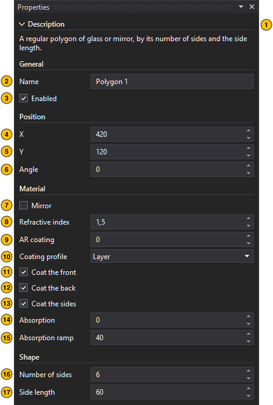

A regular polygon of glass or mirror, by its number of sides and the side length. Badges 1 to 15 are the shared and the glass and mirror settings.

16. **Number of sides**: 3 to 64.
17. **Side length**: Length of each side in pixels.

### Rectangle

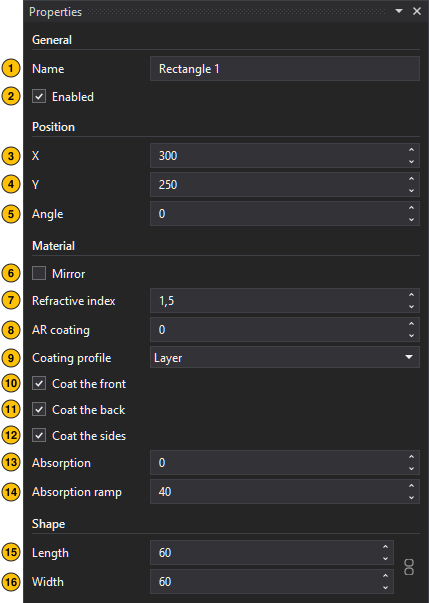

A rectangle of glass or mirror, by length and width; linked, a square. A flat mirror is a long, narrow one. Badges 1 to 15 are the shared and the glass and mirror settings.

16. **Length**: Extent along the axis in pixels.
17. **Width**: Extent across the axis in pixels.
18. **Linked**: The chain between Length and Width keeps the width equal to the length: a square.

### Ellipse

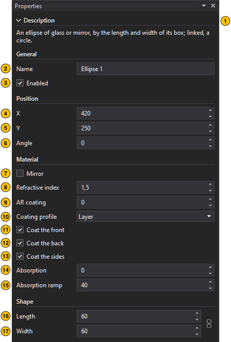

An ellipse of glass or mirror, by the length and width of its box; linked, a circle. Badges 1 to 15 are the shared and the glass and mirror settings.

16. **Length**: Diameter along the axis in pixels.
17. **Width**: Diameter across the axis in pixels.
18. **Linked**: The chain between Length and Width keeps the width equal to the length: a circle.

### Triangle

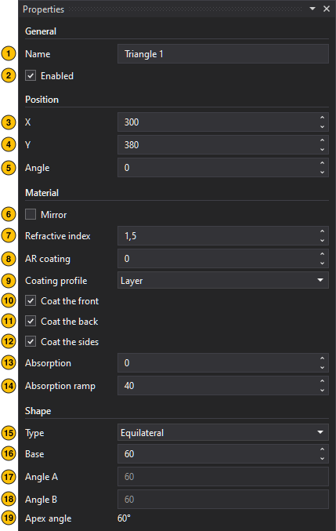

A triangle of glass or mirror: the base across the axis, the apex along it, the base angles set by a preset or by hand. Badges 1 to 15 are the shared and the glass and mirror settings.

16. **Type**: Equilateral, right isosceles (the 45° prism), 30-60-90, isosceles with one typed angle, or custom with both typed.
17. **Base**: Length of the base in pixels; the base lies across the axis, toward a source on the left.
18. **Angle A**: Base angle at the first end of the base, in degrees. Typed for the isosceles and custom types; the presets fix it.
19. **Angle B**: Base angle at the second end of the base, in degrees. Typed for the custom type; the others fix it.
20. **Apex angle**: The angle at the apex: 180° minus the two base angles. A read-out.

### Outline

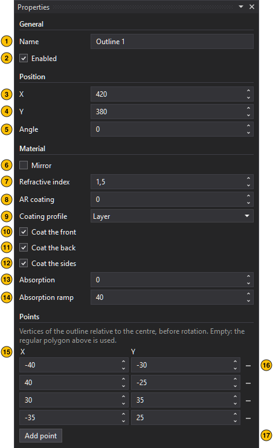

A free outline of glass or mirror: a closed shape through the points you place and drag; fewer than three paint nothing. On the pictures, a selected outline shows a handle on each point: drag it, or move it with the arrow keys. Badges 1 to 15 are the shared and the glass and mirror settings.

16. **X**: A point's position relative to the part's centre in canvas pixels, before rotation, with its Y beside it.
17. **A point's row**: X, Y and a button that removes the point.
18. **Add a point**: Appends a point after the last one.

### Fibre

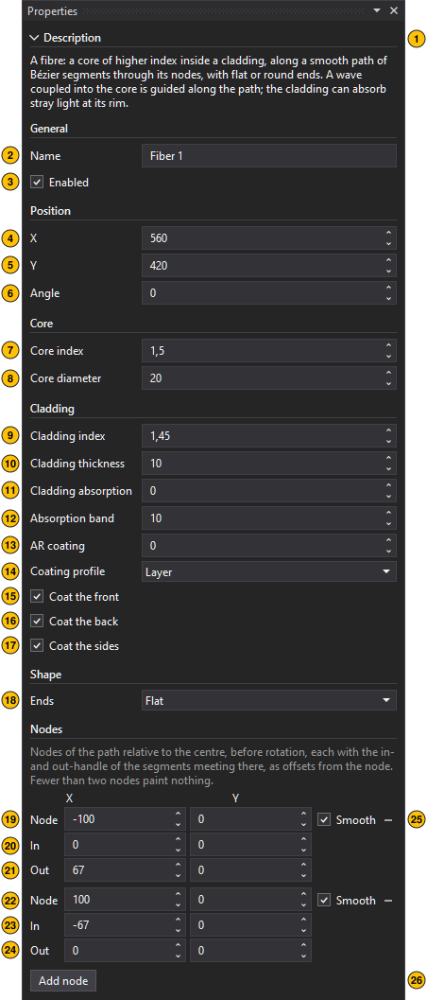

A fibre: a core of higher index inside a cladding, along a smooth path of Bézier segments through its nodes, with flat or round ends. A wave coupled into the core is guided along the path; the cladding can absorb stray light at its rim. On the pictures, a selected fibre shows its nodes and their handles: drag a node to move it with its handles, drag a handle to shape the segment arriving at or leaving the node. Badges 1 to 6 are the shared settings.

7. **Core index**: Refractive index of the core, 1.00 to 2.55 in steps of 0.01.
8. **Core diameter**: Diameter of the core in pixels.
9. **Cladding index**: Refractive index of the cladding, 1.00 to 2.55 in steps of 0.01. Below the core's index, the fibre guides.
10. **Cladding thickness**: Thickness of the cladding around the core in pixels; 0 for a bare core.
11. **Cladding absorption**: Peak absorption of the cladding's absorbing band, 0 (not at all) to 255, as the scene image's blue channel: a hump in the outer part of the cladding, rising over the band width from nothing, peaking, and falling to nothing at the outer edge, so the guided wave's tail stays untouched and stray light is absorbed from either side. Nothing on a bare core.
12. **Absorption band**: Half the absorbing band's width in pixels: the absorption rises over this many pixels to its peak and falls over as many to the outer edge. A band wider than the cladding is squeezed into it.
13. **AR coating**: Thickness in pixels of the anti-reflection band just inside the outer boundary and the end faces; 0 for none. A quarter-wave layer is λ / (4 √n) pixels thick, λ being the wavelength the source form shows; a graded band is the better the thicker, from a wavelength on.
14. **Coating profile**: As for the glass parts: a layer at √n, or a graded rise from the medium outside to the glass.
15. **Coat the front**: Coats the faces turned toward a source on the left: the start face of a fibre that runs to the right.
16. **Coat the back**: Coats the faces turned away from it: the end face.
17. **Coat the sides**: Coats the rest: the tube along the path.
18. **Ends**: How the two ends are cut: flat, straight across the path like a cleaved fibre, or rounded with the outer radius. The AR coating follows a flat end face.
19. **Node**: The first node: X and Y relative to the part's centre in canvas pixels, before rotation.
20. **In**: The node's in-handle: X and Y relative to the node, in canvas pixels before rotation. It shapes the segment arriving from the previous node; zero makes that segment straight at this end.
21. **Out**: The node's out-handle, likewise, shaping the segment leaving to the next node.
22. **Node**: The second node.
23. **In**: Its in-handle.
24. **Out**: Its out-handle.
25. **Smooth, remove**: Smooth keeps the two handles opposite each other through the node, so the path runs smoothly through it; switching it on lines them up at once. The button removes the node.
26. **Add a node**: Appends a node beyond the last one, continuing the path.

### Bragg reflector

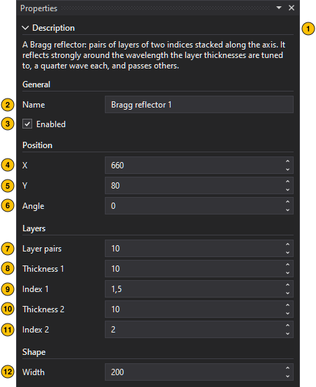

A Bragg reflector: pairs of layers of two indices stacked along the axis. It reflects strongly around the wavelength the layer thicknesses are tuned to, a quarter wave each, and passes others. Badges 1 to 6 are the shared settings.

7. **Layer pairs**: Number of layer pairs, 1 to 200.
8. **Thickness 1**: Thickness of the first layer of each pair in pixels. A quarter-wave layer is λ / (4 n) pixels thick.
9. **Index 1**: Refractive index of the first layer of each pair, 1.00 to 2.55 in steps of 0.01.
10. **Thickness 2**: Thickness of the second layer of each pair in pixels. A quarter-wave layer is λ / (4 n) pixels thick.
11. **Index 2**: Refractive index of the second layer of each pair, 1.00 to 2.55 in steps of 0.01.
12. **Width**: Extent of the stack across the axis in pixels.

### GRIN lens

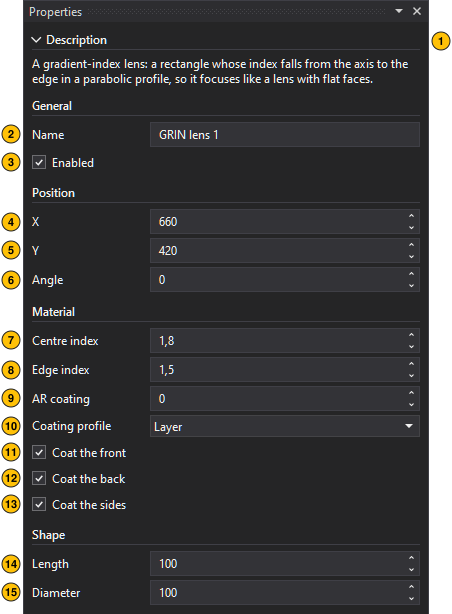

A gradient-index lens: a rectangle whose index falls from the axis to the edge in a parabolic profile, so it focuses like a lens with flat faces. Badges 1 to 6 are the shared settings.

7. **Centre index**: Refractive index on the axis, 1.00 to 2.55 in steps of 0.01.
8. **Edge index**: Refractive index at the edge, 1.00 to 2.55 in steps of 0.01. The profile between the axis and the edge is parabolic.
9. **AR coating**: The anti-reflection band just inside the outline, as for the glass parts; 0 for none.
10. **Coating profile**: A layer at √n, or a graded rise.
11. **Coat the front**: The band on the face turned toward a source on the left.
12. **Coat the back**: The band on the face turned away from it.
13. **Coat the sides**: The band on the long sides.
14. **Length**: Extent along the axis in pixels.
15. **Diameter**: Extent across the axis in pixels.

### Zone plate

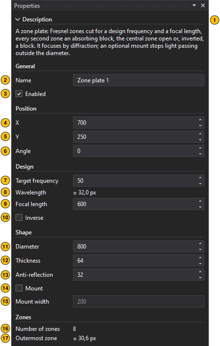

A zone plate: Fresnel zones cut for a design frequency and a focal length, every second zone an absorbing block, the central zone open or, inverted, a block. It focuses by diffraction; an optional mount stops light passing outside the diameter. Badges 1 to 6 are the shared settings.

7. **Target frequency**: The source frequency the plate is designed for, on the same scale as a source's frequency. The zones follow from the wavelength it gives, so the plate focuses this frequency at the focal length; other frequencies focus elsewhere.
8. **Wavelength**: The wavelength the design frequency gives in a medium of index 1, with the simulation's source frequency scale. A read-out.
9. **Focal length**: Distance in pixels from the plate to its focus, for a plane wave arriving along the axis.
10. **Inverse**: Exchanges the zones: the central zone becomes a block, the first ring open, and so on. The focus stays where it is.
11. **Diameter**: Extent across the axis in pixels; the zones fill it.
12. **Thickness**: Extent along the axis in pixels: the depth of the blocks. It should leave room for the anti-reflection rise on both faces.
13. **Anti-reflection**: Depth in pixels over which a block's absorption rises from nothing at its faces to its full strength, so the blocks reflect little; at most half the thickness takes effect.
14. **Mount**: Surrounds the plate with an absorbing mount, so no light passes outside its diameter. Without it, that light meets the focused light on the axis and moves the focus further out, the more so the fewer zones the plate has.
15. **Mount width**: Width in pixels of the absorbing mount on either side, beyond the diameter.
16. **Number of zones**: The zones the plate gets within its diameter. A read-out.
17. **Outermost zone**: The width of the outermost whole zone, which the grid must resolve: a few pixels at least. A read-out.

### XOR gate

An optical XOR gate: two input waveguides, a phase section putting the lower input a quarter period ahead, and a coupler whose upper output carries their difference. It lights when one input is lit, not both, for coherent inputs at the design frequency. Feed the inputs with equal waves, the same frequency, amplitude and phase; a missing wave is a logical 0. The outputs line up with the inputs of a gate placed after it, so gates can be chained, as in the example XOR AND OR logic. Badges 1 to 6 are the shared settings.

7. **Design frequency**: The source frequency the gate is designed for, on the same scale as a source's frequency: the frequency of the sources that drive it. The wavelength, and from it the core width, the coupler and the phase section, follow from it, so the gate works at this frequency only.
8. **Wavelength**: The wavelength the design frequency gives in a medium of index 1, with the simulation's source frequency scale. A read-out.
9. **Core index**: Refractive index of the waveguide cores, 1.00 to 2.55 in steps of 0.01. It must be above the cladding's; the larger the difference, the narrower the cores and the tighter the bends.
10. **Cladding index**: Refractive index of the cladding around the cores, 1.00 to 2.55 in steps of 0.01.
11. **AR coating**: Thickness in pixels of the anti-reflection band at the ends ticked below, with the index √n of the core and of the cladding; 0 for none. A quarter-wave band, the least reflecting, is λ / (4 √n) pixels thick; the form shows it for the core.
12. **AR on input side**: Puts the anti-reflection band on the input end. Switch it off where the gate takes its light from a gate before it, so the wave passes through the junction.
13. **AR on output side**: Puts the anti-reflection band on the output end. Switch it off where the gate hands its light to a gate after it, so the wave passes through the junction.
14. **Quarter-wave coating**: The thickness of the least reflecting coating on the core, λ / (4 √n). A read-out.
15. **Port spacing**: Distance between the two inputs, and between the two outputs, in pixels. A value below what the design needs to keep the arms apart is raised to it, and the box shows the spacing used.
16. **Upper output**: Lets the upper output's light leave the gate. Switched off, an absorber with a soft rise takes it in the last stretch of the arm.
17. **Lower output**: Lets the lower output's light leave the gate. Switched off, an absorber with a soft rise takes it in the last stretch of the arm.
18. **Core width**: The layout, computed from the design wavelength and the indices with the simulator's own wave equation: the width of the cores.
19. **Coupler gap**: The gap between the arms in the coupler.
20. **Coupler length**: The length of the coupler.
21. **Total length**: The length of the whole gate along its axis.
22. **Input A**: Where the upper input expects its wave, in canvas pixels; put a source there, or the output of a gate before it.
23. **Input B**: The lower input.
24. **Upper output**: Where the upper output's light leaves, in canvas pixels.
25. **Lower output**: Where the lower output's light leaves.

### AND gate

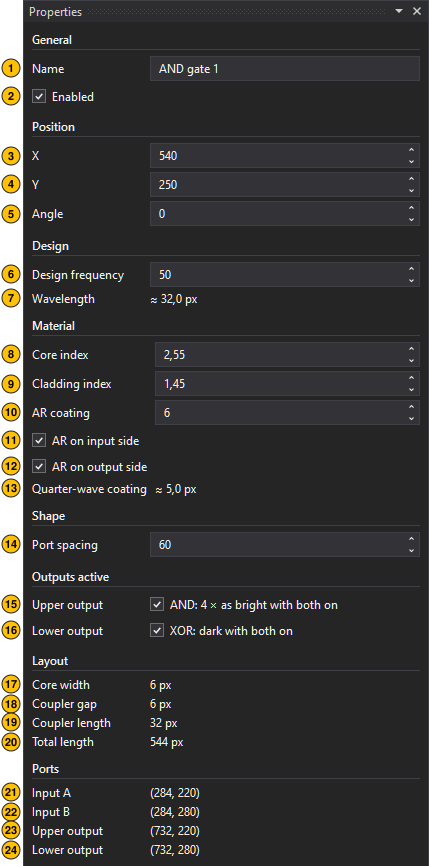

An optical AND gate: the same coupler with the lower input a quarter period behind, so the upper output carries the sum. It is brightest with both inputs lit, about four times a single one; a passive linear gate has no truer AND. Its form is the XOR gate's; see [XOR gate](#xor-gate).

### OR gate

An optical OR gate: the same coupler with the lower input a twelfth of a period ahead, so the upper output carries half the power of either input and of both. It lights with one input or both. Its form is the XOR gate's; see [XOR gate](#xor-gate).

## Probes

A probe measures the wave where you put it and draws a graph over the picture of the layer it measures. A point probe records the field's amplitude, or the intensity's value or its integral, at one pixel over the steps of the run; a line probe records the values along a line from A to B at each frame. Add a probe with the second button of the project tree; it lands at the centre of the canvas, its line end to the right. A probe's measurements are exported as CSV from its context menu, in the tree or on its graph box: a point probe one row per step, a line probe one row per frame, semicolons between the values and a header row; when the run is not complete, it is made first. Moving a probe or changing its graph needs no new run; a probe switched on, or a new one, is recorded by the next run, which starts by itself.

### Probe

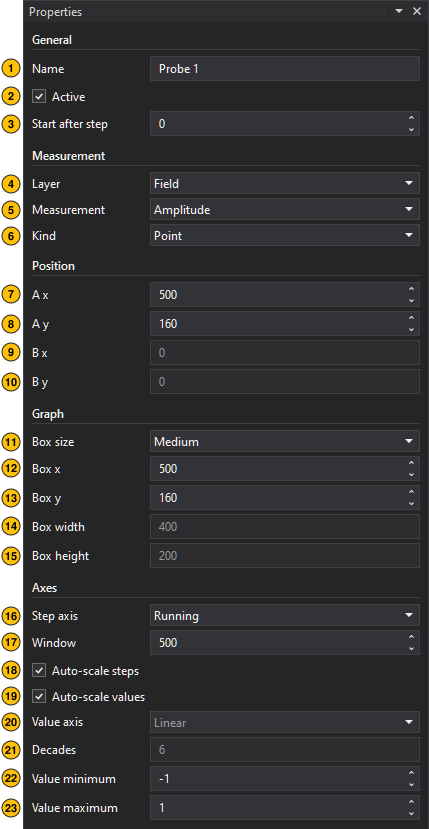

The form of a point probe of the field.

1. **Name**: Name shown in the project tree and in the graph title.
2. **Active**: Samples and draws this probe.
3. **Start after step**: Step at which recording starts; 0 records from the first step.
4. **Layer**: Field or Intensity: the output the probe samples and is drawn on.
5. **Measurement**: Recorded quantity. The field offers its amplitude only; the intensity layer its value, or the value integrated over the run.
6. **Kind**: A single point, or a line from A to B.
7. **A x**: X of the probe pixel, or of the start of the line, in canvas pixels.
8. **A y**: Y of the probe pixel, or of the start of the line, in canvas pixels.
9. **B x**: X of the end of the line in canvas pixels; line probes only.
10. **B y**: Y of the end of the line in canvas pixels; line probes only.
11. **Box size**: Nominal size of the graph box drawn over the output, from tiny to extra large, or custom; a box larger than the canvas is shrunk to fit it, aspect kept.
12. **Box x**: Left edge of the graph box in canvas pixels. A box placed on the probe's point A moves with the probe; dragging it close snaps it on.
13. **Box y**: Top edge of the graph box in canvas pixels. A box placed on the probe's point A moves with the probe; dragging it close snaps it on.
14. **Box width**: Width of the graph box in canvas pixels; custom box size only. A box larger than the canvas is shrunk to fit it, aspect kept.
15. **Box height**: Height of the graph box in canvas pixels; custom box size only. A box larger than the canvas is shrunk to fit it, aspect kept.
16. **Step axis**: Running, a sliding window of the last steps, or Full, the whole run; point probes only.
17. **Window**: Width of the sliding step window, in steps.
18. **Auto-scale steps**: Lets the step axis follow the samples recorded so far; point probes only.
19. **Auto-scale values**: Fits the value axis to the data instead of the fixed minimum and maximum.
20. **Value axis**: A linear or a logarithmic value axis; intensity probes only, the field is always linear, its amplitude axis symmetric about zero.
21. **Decades**: Decades a logarithmic value axis spans below its top; smaller values, zero included, sit on the bottom line.
22. **Value minimum**: Lower bound of the value axis when it is not auto-scaled.
23. **Value maximum**: Upper bound of the value axis when it is not auto-scaled.

### Line probe

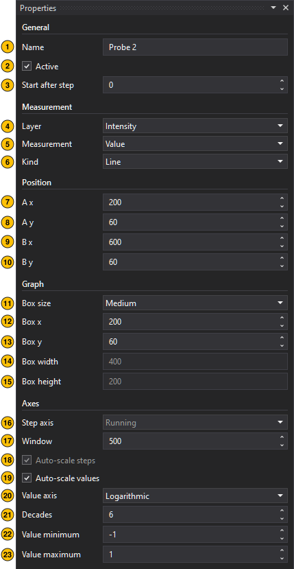

The same form for a line probe of the intensity with a logarithmic value axis. A line probe's graph shows the values along the line from A to B at the frame shown, so the step axis settings (16 to 18) do not apply; both ends have a handle on the picture, and the line between them shows where it measures.

## Colour schemes

The pictures are coloured through a colour scheme: a gradient of colour stops mapped onto the values of a picture. The Display settings pick a scheme for each picture from the schemes that ship with the program, your own schemes, saved as .wdscheme files in the `ColorSchemes` folder of your WaveDude Next data (`%LOCALAPPDATA%\WaveDudeNext\ColorSchemes`), and the schemes of the project, which are saved in its file and listed in the Colour schemes group of the tree. The picker in the Display form also offers Load from file… and Edit a copy in the project…, which makes a project scheme from the chosen one so you can change it. Renaming a project scheme keeps the pictures that use it.

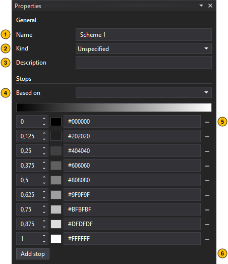

The form of a project's colour scheme.

1. **Name**: Name the display settings refer to.
2. **Kind**: Field or Intensity, the output the scheme is meant for; the pickers list it for that output only.
3. **Description**: Free text: what the scheme is, where it comes from.
4. **Based on**: Copies the stops of an existing scheme into this one, to change them from there.
5. **A stop**: Its position along the gradient, 0 at the lowest value to 1 at the highest; its colour swatch, which opens the picker (Space opens it, Enter keeps the colour, Escape puts the old one back); the colour as #RRGGBB, applied with Enter; and a button that removes the stop.
6. **Add a stop**: Inserts a stop in the widest gap, with the gradient's colour there.

In the picker, the square sets the saturation (Left, Right) and the brightness (Up, Down) and the bar the hue (Up and Down by a degree); Shift moves by ten steps; the channel boxes take 0 to 255.
