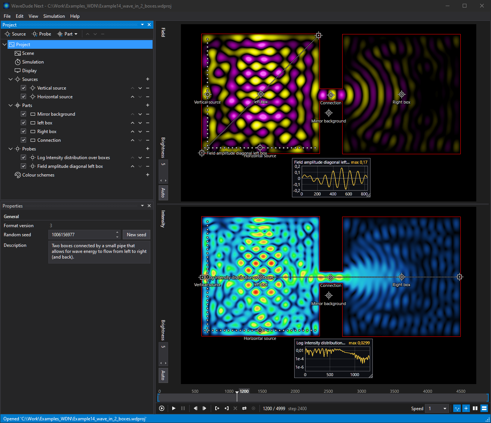

# WaveDude Next

A 2D wave simulator for optics on Windows. You place light sources and optical parts on a canvas and watch how the waves propagate, as the field itself and as the intensity they build up, while the simulation runs.



## What you see

Two pictures follow every run: the field, the wave swinging positive and negative, and the intensity, the wave's energy averaged over time. Probes record the field or the intensity at a point or along a line and show their graphs over the picture, with a linear or a logarithmic axis. You can scrub the timeline to any frame, play at any speed, loop a section, and set the brightness yourself or have it fitted to the frame. Colour schemes come with the program; you can also make your own. The interface comes in English, German, French and Dutch, in a dark or a light theme.

## Scenes

Scenes are measured in pixels; a source's wavelength in pixels is shown beside its frequency.

Sources are single points or arrays of emitters, which form beams and directional pulses. They emit continuously or in bursts, and random offsets per emitter make a source incoherent.

Optical parts go on the canvas: lenses and mirrors with spherical surfaces, polygons, rectangles, ellipses, triangles and free outlines, of glass with a refractive index of your choice or as mirrors; fibres along a curve, with core and cladding; Bragg reflectors, gradient-index lenses, zone plates, and optical XOR, AND and OR gates. Parts can have anti-reflection coatings and absorption.

A scene can also be an image from a paint program, where red stands for the refractive index, green for emitters and blue for absorption. The image is embedded in the project and refreshed when the file changes.

Everything can be moved and shaped on the picture, by handles and levers, or set by typing, and the pictures are rendered in real time while you edit: the frame on screen is recomputed after every change, and the run starts over shortly after. Undo and redo are unlimited, and objects can be copied between projects. Every control is reachable from the keyboard.

## Export

Videos are written as MP4, MPEG-1, AVI or QuickTime; frames as PNG or JPEG, in sequences or as single images; and OpenEXR files carry the raw values for NumPy, MATLAB, Octave or an EXR viewer such as [DJV](https://github.com/darbyjohnston/DJV). In and out points set the range, and probe graphs, probe markers and source markers can be drawn into the output. A probe's recorded values can be exported as CSV.

## Speed

The simulation runs on the GPU, or on the CPU where there is no suitable GPU. On the first start, the preview quality is chosen to suit the machine, and the View menu changes it at any time: for slower machines, the preview can run at a reduced resolution or with fewer frames, while exports always use the full quality. On a sufficiently fast machine, the preview can keep floating-point values and dither the pictures, which shows finer gradients. Finished frames stay in memory for scrubbing and go to disk when a run outgrows it.

## Examples

A set of example projects opens from the File menu, from a single source and a mirror to fibres, a ball lens and logic gates. WaveDude Next is the successor of Wave Dude 2D by Jeroen Vleggaar (Huygens Optics); it opens Wave Dude 2D projects directly, and the classic examples are included.

## Get it

**Download.** The [Releases](https://github.com/graealex/WaveDudeNext/releases) page offers each release as two EXEs for 64-bit Windows 10 or 11: a small one that needs the .NET 10 Desktop Runtime, which Windows offers to download on the first start if it is missing, and a larger one with the runtime inside, so nothing has to be installed. GPU acceleration uses the OpenCL driver that comes with the graphics driver. MP4 export uses Windows Media Foundation, which Windows N editions get with the Media Feature Pack.

**Build from source.** With the .NET 10 SDK installed:

```
git clone https://github.com/graealex/WaveDudeNext
cd WaveDudeNext
dotnet build -c Release WaveDudeNext.sln
```

The program is `WaveDudeNext.WPF\bin\Release\net10.0-windows\WaveDudeNext.WPF.exe`; or open the solution in Visual Studio. A single EXE comes from

```
dotnet publish WaveDudeNext.WPF\WaveDudeNext.WPF.csproj -p:PublishProfile=SingleFile
```

## Documentation

[MANUAL.md](MANUAL.md) describes every window, menu and setting, with pictures; the program shows the same text under Help > Manual.

## Problems

Report problems on the [issue tracker](https://github.com/graealex/WaveDudeNext/issues). The report template asks for the system information, which Help > About copies to the clipboard with one click, and for the log file `WaveDudeNext.WPF.log` from the folder of the program.

## Credits and license

Based on the work of

- Jeroen Vleggaar (Huygens Optics), author of Wave Dude 2D, Copyright (C) 2026: [YouTube](https://www.youtube.com/@HuygensOptics), [huygensoptics.com](https://www.huygensoptics.com)
- 0x23 (Diffraction Limited), author of WaveSimulator2D: [YouTube](https://www.youtube.com/@DiffractionLimited), [GitHub](https://github.com/0x23/WaveSimulator2D)

WaveDude Next is free software by Alexander Gräf, Copyright (C) 2026, released under the GNU General Public License version 3 or later. See [LICENSE.md](LICENSE.md).
