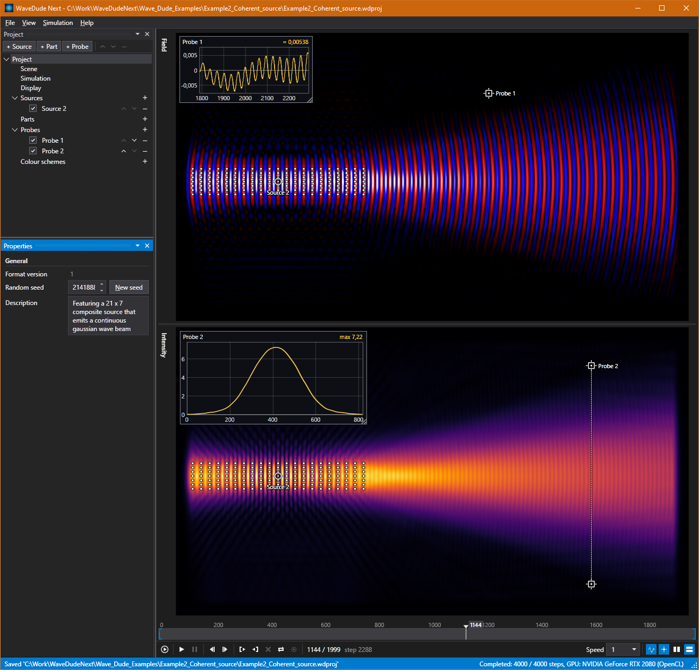

# WaveDude Next



<!-- Anchor for the real text. Facts only, checked against the code on 2026-10-16. Rewrite freely. -->

What it is
- 2D wave simulator for Windows; rewrite of Wave Dude 2D (Jeroen Vleggaar, Huygens Optics).
- Engine, probes and colour schemes descend from his program; UI, project format, live preview are new.
- GPL-3.0-or-later, same as the original.

<!-- screenshot 1: main window, finished run, field + intensity, probes with graphs. docs/main.png -->

Live preview
- Any edit recomputes the frame shown (GPU: usually under a second); after 1.5 s of quiet the full run is redone in the background.
- A running automatic run is cancelled and restarted on an edit.
- Probes update from the recomputed frame, no full run needed.
- Run button = render all frames ahead of time, then scrubbing is instant.
- Runs stay in RAM (budget: free RAM minus 2 GB, cap selectable 10..100 %); beyond that a temp file.
- Full HD, 2500 steps: about 5 s on an RTX 2080.
- Reduced preview for weak hardware: half/quarter resolution, half/quarter of the frames, 8-bit samples. Simulation and export unaffected.

Scene
- An image. Red = refractive index × 100 (100 = 1.0, 150 = 1.5; clamped 0.9..10), green = emitting pixel, blue = damping. Same rules as the original.
- Embedded in the project; the file is watched and re-embedded when it changes.
- Absorbing edge of configurable width.

Sources
- Point or composite array; continuous or pulsed; frequency, amplitude, phase, start/stop step.
- Arrays: pitch, rows/columns, rotation (handle or value), random offsets per emitter.
- Wavelength in pixels shown next to the frequency.

Probes
- Point or line; amplitude (field) or value / integrated value (intensity); start step.
- Graph box drawn on the preview; draggable, resizable, snaps to the probe.

Timeline
- Scrub, play 0.25x..4x (typed values too), step keys, in/out points (export range only), loop.
- Sources and probes draggable in both pictures; click empty space deselects.

Export
- PNG sequence, JPEG sequence, MPG (MPEG-1, I-frames only), AVI uncompressed (OpenDML, >4 GB ok), MP4 H.264 (Windows Media Foundation), MOV Animation codec (lossless RGB; Premiere/FinalCut/Resolve).
- Field, intensity or both; probe graphs and markers burned in (switchable); single frame export.
- Uses the existing run; starts one if needed. No automatic exports.

Project
- One `.wdproj` XML file; scene image and colour schemes embedded.
- Seed in the project: same project, same video.
- Wave Dude 2D `configuration.json` imports.

Colour schemes
- 23 built in (the original gradients, simplified to their bends); own schemes live in the project; colour picker.

Misc
- OpenCL GPU engine, CPU fallback; 9-point or 4th-order Laplacian.
- Keyboard-accessible throughout; dockable panes; dark/light theme; English, German, French, Dutch.
- Help > About shows version, credits, license.

Status
- No release, no installer, no docs yet.
- Planned: portable archive + signed installer; documentation file; curated examples (Jeroen); original version hosted as preserved assets.
- Later: CSV export of probe data; built-in shapes instead of painted PNGs; Avalonia port (Linux/Mac/browser).

<!-- screenshot 2: colour scheme editor with picker, or probe graphs close up. docs/editor.png -->

Build
```
git clone https://github.com/graealex/WaveDude
dotnet publish WaveDudeNext.WPF/WaveDudeNext.WPF.csproj -p:PublishProfile=SingleFile
```
- .NET 10 SDK to build; Windows 10+, .NET 10 desktop runtime to run; OpenCL driver optional; MP4 needs Media Foundation (Media Feature Pack on N editions).
- No external frameworks besides Media Foundation.

Credits (as in the source header)
- Jeroen Vleggaar (Huygens Optics), author of Wave Dude 2D, Copyright (C) 2026
  <https://www.youtube.com/@HuygensOptics>, <https://www.huygensoptics.com>
- 0x23 (Diffraction Limited), author of WaveSimulator2D
  <https://www.youtube.com/@DiffractionLimited>, <https://github.com/0x23/WaveSimulator2D>

License
- GPL-3.0-or-later; full text in LICENSE.md.
